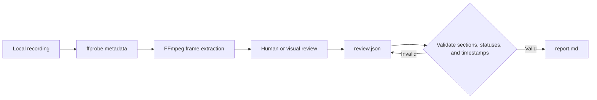

<div align="center">

# rea-game

Reverse-engineer any game video. From gameplay footage to a playable prototype

**Turn gameplay videos into timestamped evidence, a clear breakdown of their mechanics, and a practical plan for building a playable recreation.**

rea-game combines a Python CLI with a review workflow. FFmpeg extracts frames, a person or vision-capable assistant reviews the footage, and the CLI validates the review and generates a Markdown report.

Free and open source under the [MIT License](LICENSE).


[Gameplay cases](#gameplay-cases) · [Why use it](#why-use-it) · [Quick start](#quick-start) · [Example](#try-the-example) · [Review format](#review-format) · [How it works](#how-it-works) · [FAQ](#faq)


</div>

[中文](i18n/README_zh.md) | English | [Русский](i18n/README_ru.md) | [日本語](i18n/README_ja.md) | [한국어](i18n/README_ko.md) | [Español](i18n/README_es.md) | [Português](i18n/README_pt.md) | [Français](i18n/README_fr.md) | [Deutsch](i18n/README_de.md)

> Once you have the analysis, continue toward a playable recreation. If you can code, use Claude Code or Codex to build it, or choose a game development workflow with [Unity](https://unity.com/), [Unreal Engine](https://www.unrealengine.com/), or [Godot](https://godotengine.org/). If you don't code, use [Seele AI](https://www.seeles.ai) for the next development step.

## Gameplay cases

Each case includes the source video, a compressed 12-frame cover (6 columns × 2 rows), the timestamped evidence frames, the completed review, and a report with a detailed timeline and gameplay hypotheses. Observations are separated from inferences and unresolved mechanics.

### Phantom Blade Zero


[Watch Phantom Blade Zero](assets/cases/Phantom%20Blade%20Zero.mp4) · [Read the analysis report](assets/cases/analysis/phantom-blade-zero/report.md) · [Evidence](assets/cases/analysis/phantom-blade-zero/evidence.json) · [Review](assets/cases/analysis/phantom-blade-zero/review.json) · [Extracted frames](assets/cases/analysis/phantom-blade-zero/frames/)

<video controls preload="none" width="720"><source src="assets/cases/Phantom%20Blade%20Zero.mp4" type="video/mp4">Your browser cannot play this video. [Open the video file](assets/cases/Phantom%20Blade%20Zero.mp4).</video>

### Three Kingdoms Tactics


[Watch Three Kingdoms Tactics](assets/cases/Three%20Kingdoms%20Tactics.mp4) · [Read the analysis report](assets/cases/analysis/three-kingdoms-tactics/report.md) · [Evidence](assets/cases/analysis/three-kingdoms-tactics/evidence.json) · [Review](assets/cases/analysis/three-kingdoms-tactics/review.json) · [Extracted frames](assets/cases/analysis/three-kingdoms-tactics/frames/)

<video controls preload="none" width="720"><source src="assets/cases/Three%20Kingdoms%20Tactics.mp4" type="video/mp4">Your browser cannot play this video. [Open the video file](assets/cases/Three%20Kingdoms%20Tactics.mp4).</video>

### Identity V


[Watch Identity V](assets/cases/Identity%20V.mp4) · [Read the analysis report](assets/cases/analysis/identity-v/report.md) · [Evidence](assets/cases/analysis/identity-v/evidence.json) · [Review](assets/cases/analysis/identity-v/review.json) · [Extracted frames](assets/cases/analysis/identity-v/frames/)

<video controls preload="none" width="720"><source src="assets/cases/Identity%20V.mp4" type="video/mp4">Your browser cannot play this video. [Open the video file](assets/cases/Identity%20V.mp4).</video>

## Why use it?

When analyzing gameplay footage, it's easy to mix up what you can see, what you think it means, and what you still need to check. rea-game keeps those separate. Observations and inferences must cite timestamps, so readers can revisit the evidence.

Use it to study a reference game before building a prototype, organize playtest notes, or give a vision-capable assistant a consistent review process.

## Quick start

### 1. Install the tools

You need Python 3.10 or later, FFmpeg, and ffprobe. On the repository page, choose **Code → Download ZIP**, or clone it using the URL shown under **Code**. Open a terminal in the downloaded or cloned repository root, where `pyproject.toml` is located. Install from source using the steps below; `pip install rea-game` is not yet available on PyPI.

#### macOS (Terminal)

Install [Homebrew](https://brew.sh/) first, then install Python and FFmpeg:

```sh
brew install python@3.14 ffmpeg
python3.14 --version
ffmpeg -version
ffprobe -version
```

Create and activate a virtual environment, then install rea-game from the repository root:

```sh
python3.14 -m venv .venv
source .venv/bin/activate
python -m pip install .
rea-game --help
rea-game skill
```

Whenever you open a new terminal, return to the repository root and run `source .venv/bin/activate` again.

#### Windows 10/11 (PowerShell)

Install Python and FFmpeg with [WinGet](https://learn.microsoft.com/windows/package-manager/winget/):

```powershell
winget install --id Python.Python.3.14 --exact
winget install --id Gyan.FFmpeg --exact
```

Close and reopen PowerShell so the PATH changes take effect. Return to the repository root and run:

```powershell
$env:PYTHONUTF8 = "1"
py -3.14 --version
ffmpeg -version
ffprobe -version
py -3.14 -m venv .venv
.\.venv\Scripts\python.exe -m pip install .
.\.venv\Scripts\rea-game.exe --help
.\.venv\Scripts\rea-game.exe skill
```

The Windows examples call the virtual environment's executables directly, so you do not need to activate a script or change PowerShell's execution policy. Set `$env:PYTHONUTF8 = "1"` in each new PowerShell session to use UTF-8 consistently with older Python versions.

Without WinGet, install Python 3.14 from [python.org](https://www.python.org/downloads/windows/). If you use the Python install manager, run `py install 3.14` first. Get a Windows build from the [FFmpeg download page](https://ffmpeg.org/download.html), then add its `bin` directory, containing both `ffmpeg.exe` and `ffprobe.exe`, to your user PATH. Reopen PowerShell and run the version checks above. Both commands must be available in your terminal.

#### Linux (Ubuntu/Debian)

Install Python, its virtual environment support, and FFmpeg with `apt`:

```sh
sudo apt update
sudo apt install python3 python3-venv ffmpeg
python3 --version
ffmpeg -version
ffprobe -version
```

Check that `python3 --version` reports Python 3.10 or later. Then create and activate a virtual environment and install rea-game from the repository root:

```sh
python3 -m venv .venv
source .venv/bin/activate
python -m pip install .
rea-game --help
rea-game skill
```

### 2. Extract frames and review the footage

macOS / Linux, with the virtual environment activated:

```sh
rea-game extract "/path/to/gameplay.mp4" -o out/my-game --interval 3
```

Windows PowerShell:

```powershell
.\.venv\Scripts\rea-game.exe extract "C:\Videos\gameplay.mp4" -o out/my-game --interval 3
```

Replace the video path with your own. Keep the quotes around paths that contain spaces. `--interval` is the number of seconds between frames and defaults to 5. It must be a finite number greater than zero. Intervals that cause the frame count to overflow are rejected.

For files with multiple video tracks, rea-game uses the first track that is not a cover image. The frame dimensions, duration when available on the track, and extracted images all use that track.

The command creates a new directory:

```text
out/my-game/
├── evidence.json   # Source, duration, dimensions, audio presence, and frame timestamps
├── frames/         # Extracted JPEG frames
└── review.json     # Review template to fill in
```

Inspect the frames, then watch the original footage around important events to check what happens between them. Listen to the audio before making claims about sound. Timestamps indicate requested seek positions; the decoded frames may differ slightly.

### 3. Generate a report

Open `out/my-game/review.json` in a text editor, add your findings using the [review format](#review-format), and save it as UTF-8. Write in English by default. Then run:

macOS / Linux:

```sh
rea-game report out/my-game
```

Windows PowerShell:

```powershell
.\.venv\Scripts\rea-game.exe report out/my-game
```

The report is saved to `out/my-game/report.md`. It covers the gameplay loop, controls, rules, progression, interface, art, sound, prototype plan, and open questions, followed by suggested next steps for continuing toward a playable recreation. Empty sections say "Not yet reviewed."

## Try the example

The repository includes a generator for a three-second synthetic clip: a white square on a black background changes position at the one-second mark. It demonstrates the extraction and reporting workflow without downloading game assets. It is not a full gameplay example.

| 0 seconds                                                                       | 1 second                                                                                    |
| ------------------------------------------------------------------------------- | ------------------------------------------------------------------------------------------- |
|  |  |

Run from the repository root. On macOS / Linux, activate the virtual environment first:

```sh
python examples/synthetic/create_video.py out/synthetic.mp4
rea-game extract out/synthetic.mp4 -o out/synthetic --interval 1
cp examples/synthetic/review.json out/synthetic/review.json
rea-game report out/synthetic
```

Windows PowerShell:

```powershell
$env:PYTHONUTF8 = "1"
.\.venv\Scripts\python.exe examples/synthetic/create_video.py out/synthetic.mp4
.\.venv\Scripts\rea-game.exe extract out/synthetic.mp4 -o out/synthetic --interval 1
Copy-Item examples/synthetic/review.json out/synthetic/review.json
.\.venv\Scripts\rea-game.exe report out/synthetic
```

Before copying the example review, inspect the frames and play the clip to verify the change. Use a new video path and output directory when you run the example again.

See the [example report](examples/synthetic/report.md), [review file](examples/synthetic/review.json), and [step-by-step walkthrough](examples/synthetic/README.md). The example report uses `out/synthetic.mp4` as its source path; your generated report records the actual local path.

## Review format

Each section contains an array of entries. Every entry needs `text` and `status`; `times` is optional except for observations and inferences, which must cite at least one timestamp within the recording:

```json
{
  "core_loop": [
    {
      "text": "The counter increases when the character touches an item.",
      "status": "observation",
      "times": [12.3]
    }
  ],
  "unknowns": [
    {
      "text": "Do collected items respawn after a delay?",
      "status": "unverified",
      "times": []
    }
  ],
  "remake": [
    {
      "text": "Start with movement, item collection, and an on-screen counter.",
      "status": "proposal",
      "times": []
    }
  ]
}
```

These are format examples, not findings about your video. Keep the section keys from the generated template. Unknown sections and entry fields are rejected to catch typos.

| Status        | Use it for                                                    | Timestamps |
| ------------- | ------------------------------------------------------------- | ---------- |
| `observation` | Something directly visible or audible in the recording        | Required   |
| `inference`   | An interpretation supported by evidence but not yet confirmed | Required   |
| `unverified`  | A question or claim the footage cannot resolve                | Optional   |
| `proposal`    | A suggested approach for building a prototype                 | Optional   |

A prototype plan should identify the smallest playable version, core mechanics, required scenes and assets, and implementation order. Footage alone usually cannot establish input mappings, hidden values, every win or loss condition, or the original technology stack. Keep those uncertainties explicit.

## How it works



The CLI uses the Python standard library for arguments, JSON, files, and subprocesses. FFmpeg handles video decoding. Review data is readable JSON, and reports are plain Markdown. No model, API key, or network connection is needed to run the installed tool. If you use a cloud assistant, its own workflow determines whether your footage is uploaded.

Before generating a report, rea-game checks:

- A nonempty source, a finite positive duration, and a valid frame index in `evidence.json`.
- Known section names and entry fields in `review.json`.
- Valid statuses, nonempty text, and finite timestamps within the recording. Observations and inferences must include timestamps.

Extraction requires a new output directory to protect existing reviews. If extraction fails, the directory created by that run is removed so you can retry. Generating a report overwrites `report.md` in the selected directory.

## Tests and packages

Tests cover the full FFmpeg-to-report workflow, consistency across video tracks, tiny intervals, invalid JSON, field validation, timestamp bounds, and cleanup after failed extraction. CI is configured for Python 3.10 and 3.14 on Linux, macOS, and Windows. It runs tests, builds a wheel and source distribution, and installs each package in an isolated environment to run the example. It does not publish packages. Check the repository's Actions runs for actual results.

See [CONTRIBUTING.md](CONTRIBUTING.md) for development and release checks.

## FAQ

<details>
<summary>Is rea-game free?</summary>

Yes. rea-game is open-source software released under the MIT License. The CLI has no subscription, API key, or usage fee. Any paid AI assistant or development service you choose to use is separate.

</details>

<details>
<summary>What does rea-game do?</summary>

rea-game turns gameplay video clips into a structured, evidence-based analysis report that can support prototype development. It extracts timestamped frames, provides a review workflow for gameplay, controls, rules, progression, UI, art, and audio, validates the review, and creates a Markdown report with a prototype plan and open questions.

</details>

<details>
<summary>Does rea-game analyze the video automatically?</summary>

No. The CLI extracts frames and generates a report from your review; it does not understand gameplay by itself. A person or vision-capable assistant must inspect the frames and relevant video segments, then add the analysis. Mark details that the footage cannot establish as unverified rather than treating a guess as a confirmed rule.

</details>

<details>
<summary>What is the analysis report useful for?</summary>

Use it to understand and communicate a game's visible gameplay loop, interactions, feedback, and unresolved mechanics. Its prototype plan turns those findings into a starting scope, core mechanics, suggested scenes and assets, technology options, and an implementation order. It gives you a practical handoff for planning a playable recreation; it is not a complete game specification.

</details>

<details>
<summary>Can I build a playable game from the report?</summary>

The report gives you a grounded starting point, not finished game code or assets. If you can code, continue with Claude Code or Codex, or build with [Unity](https://unity.com/), [Unreal Engine](https://www.unrealengine.com/), or [Godot](https://godotengine.org/). If you don't code, use [Seele AI](https://www.seeles.ai) for the next development step.

</details>

<details>
<summary>Do I need programming skills to use rea-game?</summary>

You do not need game-development skills, but rea-game is a local command-line workflow, not a one-click web service. You will need to install Python and FFmpeg, run a few commands, and add findings to `review.json`. You can inspect the footage yourself or ask a vision-capable assistant to help review it. The report then helps you choose a development path that fits your skills.

</details>

<details>
<summary>What kind of video should I analyze?</summary>

Use a gameplay recording that shows player actions and the resulting on-screen feedback. A short clip can explain a specific interaction; a longer recording that includes a complete gameplay loop gives stronger context. When a clip omits controls, outcomes, or transitions, record those as open questions.

</details>

<details>
<summary>Does my video leave my computer?</summary>

The CLI processes a local video file and does not require a model, API key, or network connection. If you ask a cloud assistant to inspect your footage, whether it is uploaded depends on that assistant's workflow and settings.

</details>

<details>
<summary>Why does extraction require a new directory?</summary>

To protect existing review work. You manage successful output directories yourself; a failed extraction removes only the directory it created.

</details>

<details>
<summary>Can I write review entries in another language?</summary>

Yes. English is the default for the CLI, report headings, examples, and assistant workflow. The report preserves the text you enter; it does not translate it. Status values must always be `observation`, `inference`, `unverified`, or `proposal`.

</details>

<details>
<summary>What should I check before sharing a report?</summary>

Both the report and `evidence.json` include the video's local path. Check for private paths before sharing, and make sure you have permission to use the footage, screenshots, music, and game assets. The repository's MIT license does not grant rights to third-party game content.

</details>

## Contributing

Bug reports, suggestions, and pull requests are welcome. See the [contribution guide](CONTRIBUTING.md) for setup, issue reporting, and release checks.

macOS / Linux, with the virtual environment activated:

```sh
python -m unittest discover -s tests
```

Windows PowerShell:

```powershell
$env:PYTHONUTF8 = "1"
.\.venv\Scripts\python.exe -m unittest discover -s tests
```

## Credits and license

Inspired by REA (Reverse Engineer Anything): trace from what you see back to how it was made, back every claim with evidence, and verify by measurement.

The code and original synthetic example are available under the [MIT license](LICENSE). See the [review workflow](rea_game/SKILL.md) and [changelog](CHANGELOG.md) for more details.
