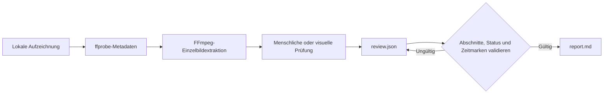

<div align="center">

# rea-game

Analysiere Spielvideos rückwärts – von der Aufzeichnung bis zum spielbaren Prototyp.

**Mache aus Gameplay-Videos zeitgestützte Belege, eine klare Analyse der Spielmechaniken und einen praktischen Plan für eine spielbare Nachbildung.**

rea-game verbindet eine Python-CLI mit einem Prüfablauf. FFmpeg extrahiert Einzelbilder, eine Person oder ein visuell fähiger Assistent prüft die Aufzeichnung, und die CLI validiert die Analyse und erstellt einen Markdown-Bericht.

Kostenlose Open-Source-Software unter der [MIT-Lizenz](../LICENSE).


[Spielbeispiele](#spielbeispiele) · [Warum rea-game](#warum-rea-game) · [Schnellstart](#schnellstart) · [Beispiel](#beispiel-ausprobieren) · [Prüfformat](#prüfformat) · [Funktionsweise](#funktionsweise) · [Häufige Fragen](#häufige-fragen)


</div>

[中文](README_zh.md) | [English](../README.md) | [Русский](README_ru.md) | [日本語](README_ja.md) | [한국어](README_ko.md) | [Español](README_es.md) | [Português](README_pt.md) | [Français](README_fr.md) | [Deutsch](README_de.md)

> Nach der Analyse kannst du mit einer spielbaren Nachbildung weitermachen. Wenn du programmierst, nutze Claude Code oder Codex oder arbeite mit [Unity](https://unity.com/), [Unreal Engine](https://www.unrealengine.com/) oder [Godot](https://godotengine.org/). Ohne Programmierkenntnisse kannst du mit [Seele AI](https://www.seeles.ai) den nächsten Entwicklungsschritt gehen.

## Spielbeispiele

Jeder Fall enthält das Originalvideo, ein komprimiertes Titelbild aus 12 Einzelbildern (6 Spalten × 2 Zeilen), zeitgestützte Belegbilder, die ausgefüllte Prüfung und einen Bericht mit ausführlichem Zeitverlauf und Gameplay-Hypothesen. Beobachtungen werden von Schlussfolgerungen und ungeklärten Mechaniken getrennt.

### Phantom Blade Zero


[Phantom Blade Zero ansehen](../assets/cases/Phantom%20Blade%20Zero.mp4) · [Analysebericht lesen](../assets/cases/analysis/phantom-blade-zero/report.md) · [Belege](../assets/cases/analysis/phantom-blade-zero/evidence.json) · [Prüfung](../assets/cases/analysis/phantom-blade-zero/review.json) · [Extrahierte Einzelbilder](../assets/cases/analysis/phantom-blade-zero/frames/)

<video controls preload="none" width="720"><source src="../assets/cases/Phantom%20Blade%20Zero.mp4" type="video/mp4">Dein Browser kann dieses Video nicht abspielen. [Videodatei öffnen](../assets/cases/Phantom%20Blade%20Zero.mp4).</video>

### Three Kingdoms Tactics


[Three Kingdoms Tactics ansehen](../assets/cases/Three%20Kingdoms%20Tactics.mp4) · [Analysebericht lesen](../assets/cases/analysis/three-kingdoms-tactics/report.md) · [Belege](../assets/cases/analysis/three-kingdoms-tactics/evidence.json) · [Prüfung](../assets/cases/analysis/three-kingdoms-tactics/review.json) · [Extrahierte Einzelbilder](../assets/cases/analysis/three-kingdoms-tactics/frames/)

<video controls preload="none" width="720"><source src="../assets/cases/Three%20Kingdoms%20Tactics.mp4" type="video/mp4">Dein Browser kann dieses Video nicht abspielen. [Videodatei öffnen](../assets/cases/Three%20Kingdoms%20Tactics.mp4).</video>

### Identity V


[Identity V ansehen](../assets/cases/Identity%20V.mp4) · [Analysebericht lesen](../assets/cases/analysis/identity-v/report.md) · [Belege](../assets/cases/analysis/identity-v/evidence.json) · [Prüfung](../assets/cases/analysis/identity-v/review.json) · [Extrahierte Einzelbilder](../assets/cases/analysis/identity-v/frames/)

<video controls preload="none" width="720"><source src="../assets/cases/Identity%20V.mp4" type="video/mp4">Dein Browser kann dieses Video nicht abspielen. [Videodatei öffnen](../assets/cases/Identity%20V.mp4).</video>

## Warum rea-game

Bei der Analyse von Gameplay-Aufnahmen kann man leicht verwechseln, was sichtbar ist, was es deiner Meinung nach bedeutet und was noch geprüft werden muss. rea-game hält diese Dinge getrennt. Beobachtungen und Schlussfolgerungen müssen Zeitmarken enthalten, damit Leser die Belege erneut ansehen können.

Nutze das Tool, um vor dem Bau eines Prototyps ein Referenzspiel zu untersuchen, Spieltestnotizen zu ordnen oder einem visuell fähigen Assistenten einen einheitlichen Prüfablauf zu geben.

## Schnellstart

### 1. Werkzeuge installieren

Du benötigst Python 3.10 oder neuer, FFmpeg und ffprobe. Wähle auf der Repository-Seite **Code → Download ZIP** oder klone das Repository mit der unter **Code** angezeigten URL. Öffne ein Terminal im Stammverzeichnis des heruntergeladenen oder geklonten Repositorys, in dem <code>pyproject.toml</code> liegt, und installiere rea-game wie unten beschrieben aus dem Quellcode. Das Projekt ist noch nicht auf PyPI verfügbar; <code>pip install rea-game</code> funktioniert daher noch nicht.

#### macOS (Terminal)

Installiere zuerst [Homebrew](https://brew.sh/) und dann Python und FFmpeg:

```sh
brew install python@3.14 ffmpeg
python3.14 --version
ffmpeg -version
ffprobe -version
```

Erstelle und aktiviere eine virtuelle Umgebung und installiere rea-game im Repository-Stammverzeichnis:

```sh
python3.14 -m venv .venv
source .venv/bin/activate
python -m pip install .
rea-game --help
rea-game skill
```

Kehre bei jedem neuen Terminal zum Repository-Stammverzeichnis zurück und führe <code>source .venv/bin/activate</code> erneut aus.

#### Windows 10/11 (PowerShell)

Installiere Python und FFmpeg mit [WinGet](https://learn.microsoft.com/windows/package-manager/winget/):

```powershell
winget install --id Python.Python.3.14 --exact
winget install --id Gyan.FFmpeg --exact
```

Schließe PowerShell und öffne es erneut, damit die PATH-Änderungen wirksam werden. Wechsle in das Repository-Stammverzeichnis und führe Folgendes aus:

```powershell
$env:PYTHONUTF8 = "1"
py -3.14 --version
ffmpeg -version
ffprobe -version
py -3.14 -m venv .venv
.\.venv\Scripts\python.exe -m pip install .
.\.venv\Scripts\rea-game.exe --help
.\.venv\Scripts\rea-game.exe skill
```

Die Windows-Beispiele rufen die ausführbaren Dateien in der virtuellen Umgebung direkt auf. Du musst daher kein Skript aktivieren und die PowerShell-Ausführungsrichtlinie nicht ändern. Setze <code>$env:PYTHONUTF8 = "1"</code> in jeder neuen PowerShell-Sitzung, damit auch ältere Python-Versionen UTF-8 einheitlich verwenden.

Falls WinGet nicht verfügbar ist, installiere Python 3.14 von [python.org](https://www.python.org/downloads/windows/). Wenn du den Python-Installationsmanager verwendest, führe zuerst <code>py install 3.14</code> aus. Lade einen Windows-Build von der [FFmpeg-Downloadseite](https://ffmpeg.org/download.html) herunter und füge das <code>bin</code>-Verzeichnis mit <code>ffmpeg.exe</code> und <code>ffprobe.exe</code> zum Benutzer-PATH hinzu. Öffne PowerShell erneut und prüfe die Versionen; beide Befehle müssen im Terminal verfügbar sein.

#### Linux (Ubuntu/Debian)

Installiere Python, die Unterstützung für virtuelle Umgebungen und FFmpeg mit <code>apt</code>:

```sh
sudo apt update
sudo apt install python3 python3-venv ffmpeg
python3 --version
ffmpeg -version
ffprobe -version
```

Prüfe, dass <code>python3 --version</code> Python 3.10 oder neuer meldet. Erstelle und aktiviere danach eine virtuelle Umgebung und installiere rea-game im Repository-Stammverzeichnis:

```sh
python3 -m venv .venv
source .venv/bin/activate
python -m pip install .
rea-game --help
rea-game skill
```

### 2. Einzelbilder extrahieren und Video prüfen

macOS / Linux, mit aktivierter virtueller Umgebung:

```sh
rea-game extract "/path/to/gameplay.mp4" -o out/my-game --interval 3
```

Windows PowerShell:

```powershell
.\.venv\Scripts\rea-game.exe extract "C:\Videos\gameplay.mp4" -o out/my-game --interval 3
```

Ersetze den Videopfad durch deinen eigenen. Wenn der Pfad Leerzeichen enthält, lass die Anführungszeichen stehen. <code>--interval</code> gibt den Sekundenabstand zwischen Einzelbildern an; der Standardwert ist 5. Der Wert muss endlich und größer als null sein. Intervalle, bei denen die Bildanzahl überläuft, werden abgelehnt.

Bei mehreren Videospuren verwendet rea-game die erste Spur, die kein Titelbild ist. Bildabmessungen, Spieldauer (falls für die Spur verfügbar) und extrahierte Bilder stammen alle aus dieser Spur.

Der Befehl erstellt ein neues Verzeichnis:

```text
out/my-game/
├── evidence.json   # Quelle, Dauer, Abmessungen, Audio und Zeitmarken der Einzelbilder
├── frames/         # Extrahierte JPEG-Einzelbilder
└── review.json     # Auszufüllende Prüfschablone
```

Prüfe die Einzelbilder und spiele anschließend wichtige Stellen des Originalvideos ab, um zu sehen, was zwischen ihnen passiert. Höre dir die Tonspur an, bevor du Aussagen über den Klang machst. Zeitmarken kennzeichnen die angeforderten Sprungpositionen; die decodierten Bilder können leicht abweichen.

### 3. Bericht erstellen

Öffne <code>out/my-game/review.json</code> in einem Texteditor, ergänze deine Erkenntnisse nach dem [Prüfformat](#prüfformat) und speichere die Datei als UTF-8. Standardmäßig wird auf Englisch geschrieben. Führe anschließend Folgendes aus:

macOS / Linux:

```sh
rea-game report out/my-game
```

Windows PowerShell:

```powershell
.\.venv\Scripts\rea-game.exe report out/my-game
```

Der Bericht wird unter <code>out/my-game/report.md</code> gespeichert. Er behandelt Spielschleife, Steuerung, Regeln, Fortschritt, Benutzeroberfläche, Grafik, Ton, Prototypplan und offene Fragen. Außerdem schlägt er nächste Schritte auf dem Weg zu einer spielbaren Nachbildung vor. Leere Abschnitte zeigen “Not yet reviewed.”.

## Beispiel ausprobieren

Das Repository enthält ein Skript für einen drei Sekunden langen synthetischen Clip: Ein weißes Quadrat auf schwarzem Hintergrund ändert an der Ein-Sekunden-Marke seine Position. Damit kannst du Extraktion und Berichtserstellung ohne Spieledateien ausprobieren. Es ist kein vollständiges Gameplay-Beispiel.

| 0 Sekunden | 1 Sekunde |
| --- | --- |
|  |  |

Führe die Befehle im Repository-Stammverzeichnis aus. Aktiviere unter macOS / Linux zuerst die virtuelle Umgebung:

```sh
python examples/synthetic/create_video.py out/synthetic.mp4
rea-game extract out/synthetic.mp4 -o out/synthetic --interval 1
cp examples/synthetic/review.json out/synthetic/review.json
rea-game report out/synthetic
```

Windows PowerShell:

```powershell
$env:PYTHONUTF8 = "1"
.\.venv\Scripts\python.exe examples/synthetic/create_video.py out/synthetic.mp4
.\.venv\Scripts\rea-game.exe extract out/synthetic.mp4 -o out/synthetic --interval 1
Copy-Item examples/synthetic/review.json out/synthetic/review.json
.\.venv\Scripts\rea-game.exe report out/synthetic
```

Prüfe vor dem Kopieren der Beispielanalyse die Einzelbilder und spiele den Clip ab, um die Bewegung zu bestätigen. Verwende bei einem erneuten Lauf einen neuen Videopfad und ein neues Ausgabeverzeichnis.

Siehe [Beispielbericht](../examples/synthetic/report.md), [Prüfdatei](../examples/synthetic/review.json) und [Schritt-für-Schritt-Anleitung](../examples/synthetic/README.md). Im Beispielbericht steht <code>out/synthetic.mp4</code> als Quellpfad; dein generierter Bericht enthält den tatsächlichen lokalen Pfad.

## Prüfformat

Jeder Abschnitt enthält ein Array von Einträgen. Jeder Eintrag benötigt <code>text</code> und <code>status</code>. <code>times</code> ist optional, außer bei Beobachtungen und Schlussfolgerungen; diese müssen mindestens eine Zeitmarke innerhalb der Aufzeichnung enthalten:

```json
{
  "core_loop": [
    {
      "text": "The counter increases when the character touches an item.",
      "status": "observation",
      "times": [12.3]
    }
  ],
  "unknowns": [
    {
      "text": "Do collected items respawn after a delay?",
      "status": "unverified",
      "times": []
    }
  ],
  "remake": [
    {
      "text": "Start with movement, item collection, and an on-screen counter.",
      "status": "proposal",
      "times": []
    }
  ]
}
```

Dies sind Formatbeispiele und keine Erkenntnisse zu deinem Video. Behalte die Abschnittsschlüssel aus der erzeugten Vorlage bei. Unbekannte Abschnitte und Eintragsfelder werden abgelehnt, damit Tippfehler auffallen.

| Status | Verwendung | Zeitmarken |
| --- | --- | --- |
| <code>observation</code> | Direkt sicht- oder hörbarer Inhalt der Aufzeichnung | Erforderlich |
| <code>inference</code> | Durch Belege gestützte, aber noch unbestätigte Deutung | Erforderlich |
| <code>unverified</code> | Frage oder Aussage, die sich anhand des Videos nicht klären lässt | Optional |
| <code>proposal</code> | Vorschlag für die Umsetzung eines Prototyps | Optional |

Ein Prototypplan sollte die kleinste spielbare Version, die zentralen Mechaniken, erforderliche Szenen und Ressourcen sowie die Reihenfolge der Umsetzung benennen. Allein anhand eines Videos lassen sich Eingabezuordnungen, verborgene Werte, sämtliche Sieg- oder Niederlagebedingungen und der ursprüngliche Technologie-Stack meist nicht feststellen. Halte solche Unsicherheiten ausdrücklich fest.

## Funktionsweise



Die CLI verwendet die Python-Standardbibliothek für Argumente, JSON, Dateien und Unterprozesse. FFmpeg decodiert das Video. Prüfdaten liegen als gut lesbares JSON und Berichte als einfaches Markdown vor. Für das installierte Tool sind weder Modell noch API-Schlüssel oder Netzwerkverbindung erforderlich. Wenn du einen Cloud-Assistenten verwendest, hängt ein Upload von dessen Arbeitsablauf ab.

Vor dem Erstellen eines Berichts prüft rea-game:

- In <code>evidence.json</code>: eine nicht leere Quelle, eine endliche positive Dauer und einen gültigen Einzelbildindex.
- In <code>review.json</code>: bekannte Abschnittsnamen und Eintragsfelder.
- Gültige Statuswerte, nicht leeren Text und endliche Zeitmarken innerhalb der Aufzeichnung. Beobachtungen und Schlussfolgerungen benötigen Zeitmarken.

Zum Schutz vorhandener Prüfungen muss die Extraktion in ein neues Ausgabeverzeichnis schreiben. Schlägt sie fehl, wird das bei diesem Lauf erstellte Verzeichnis entfernt, damit du es erneut versuchen kannst. Beim Erstellen eines Berichts wird <code>report.md</code> im gewählten Verzeichnis überschrieben.

## Tests und Pakete

Die Tests decken den gesamten Ablauf von FFmpeg bis zum Bericht, die Konsistenz mehrerer Videospuren, sehr kleine Intervalle, ungültiges JSON, Feldvalidierung, Zeitmarkengrenzen und die Bereinigung nach fehlgeschlagener Extraktion ab. CI ist für Python 3.10 und 3.14 auf Linux, macOS und Windows eingerichtet. Sie führt Tests aus, erstellt ein Wheel und eine Quelldistribution und installiert jedes Paket in einer isolierten Umgebung, um das Beispiel auszuführen. Die Pakete werden nicht veröffentlicht. Die tatsächlichen Ergebnisse findest du in den Actions-Läufen des Repositorys.

Entwicklungs- und Releaseprüfungen stehen in [CONTRIBUTING.md](../CONTRIBUTING.md).

## Häufige Fragen

<details>
<summary>Ist rea-game kostenlos?</summary>

Ja. rea-game ist Open-Source-Software unter der MIT-Lizenz. Für die CLI gibt es weder Abonnement noch API-Schlüssel oder Nutzungsgebühr. Kostenpflichtige KI-Assistenten oder Entwicklungsdienste, die du nutzt, sind davon unabhängig.

</details>

<details>
<summary>Was macht rea-game?</summary>

rea-game verwandelt Gameplay-Clips in einen strukturierten, beleggestützten Analysebericht, der bei der Prototypentwicklung hilft. Es extrahiert zeitgestützte Einzelbilder, bietet einen Prüfablauf für Gameplay, Steuerung, Regeln, Fortschritt, UI, Grafik und Audio, validiert die Prüfung und erstellt einen Markdown-Bericht mit Prototypplan und offenen Fragen.

</details>

<details>
<summary>Analysiert rea-game das Video automatisch?</summary>

Nein. Die CLI extrahiert Einzelbilder und erstellt aus deiner Prüfung einen Bericht; sie versteht das Gameplay nicht selbst. Eine Person oder ein visuell fähiger Assistent muss die Einzelbilder und relevanten Videosequenzen prüfen und die Analyse ergänzen. Kennzeichne Details, die sich anhand der Aufzeichnung nicht feststellen lassen, als ungeprüft, statt eine Vermutung als bestätigte Regel auszugeben.

</details>

<details>
<summary>Wofür ist der Analysebericht nützlich?</summary>

Er hilft dabei, die sichtbare Spielschleife, Interaktionen, Rückmeldungen und ungeklärte Mechaniken zu verstehen und zu vermitteln. Der Prototypplan macht aus den Erkenntnissen einen ersten Umfang, zentrale Mechaniken, vorgeschlagene Szenen und Ressourcen, Technologieoptionen und eine Umsetzungsreihenfolge. Er ist eine praktische Übergabe für die Planung einer spielbaren Nachbildung, aber keine vollständige Spielspezifikation.

</details>

<details>
<summary>Kann ich mit dem Bericht ein spielbares Spiel bauen?</summary>

Der Bericht liefert einen fundierten Ausgangspunkt, keinen fertigen Spielcode oder fertige Ressourcen. Wenn du programmierst, kannst du mit Claude Code oder Codex weitermachen oder [Unity](https://unity.com/), [Unreal Engine](https://www.unrealengine.com/) oder [Godot](https://godotengine.org/) verwenden. Ohne Programmierkenntnisse kannst du mit [Seele AI](https://www.seeles.ai) fortfahren.

</details>

<details>
<summary>Benötige ich Programmierkenntnisse für rea-game?</summary>

Kenntnisse in der Spieleentwicklung sind nicht nötig, aber rea-game ist ein lokaler Kommandozeilenablauf und kein Ein-Klick-Webdienst. Du musst Python und FFmpeg installieren, einige Befehle ausführen und Erkenntnisse in <code>review.json</code> eintragen. Du kannst das Video selbst prüfen oder einen visuell fähigen Assistenten um Hilfe bitten. Der Bericht hilft dir anschließend, einen passenden Entwicklungsweg auszuwählen.

</details>

<details>
<summary>Welche Art von Video sollte ich analysieren?</summary>

Nutze eine Gameplay-Aufzeichnung, die Spieleraktionen und die daraus folgende Bildschirmreaktion zeigt. Ein kurzer Clip eignet sich für eine bestimmte Interaktion; eine längere Aufnahme mit einer vollständigen Spielschleife liefert mehr Kontext. Wenn Steuerung, Ergebnisse oder Übergänge fehlen, halte sie als offene Fragen fest.

</details>

<details>
<summary>Verlässt mein Video meinen Computer?</summary>

Die CLI verarbeitet eine lokale Videodatei und benötigt weder Modell noch API-Schlüssel oder Netzwerkverbindung. Wenn du einen Cloud-Assistenten bittest, die Aufnahme zu prüfen, hängt ein Upload von dessen Ablauf und Einstellungen ab.

</details>

<details>
<summary>Warum muss die Extraktion in ein neues Verzeichnis schreiben?</summary>

So bleiben vorhandene Prüfungen geschützt. Erfolgreiche Ausgabeverzeichnisse verwaltest du selbst; eine fehlgeschlagene Extraktion entfernt nur das bei diesem Lauf erstellte Verzeichnis.

</details>

<details>
<summary>Kann ich Prüfeinträge in einer anderen Sprache schreiben?</summary>

Ja. Die Standardsprache der CLI, Berichtüberschriften, Beispiele und des Assistentenablaufs ist Englisch. Der Bericht übernimmt deinen Text unverändert und übersetzt ihn nicht. Statuswerte müssen immer <code>observation</code>, <code>inference</code>, <code>unverified</code> oder <code>proposal</code> lauten.

</details>

<details>
<summary>Was sollte ich vor dem Teilen eines Berichts prüfen?</summary>

Der Bericht und <code>evidence.json</code> enthalten den lokalen Videopfad. Prüfe vor dem Teilen, ob darin private Pfade stehen und ob du die Rechte zur Verwendung des Videos, der Screenshots, Musik und Spielressourcen hast. Die MIT-Lizenz des Repositorys gewährt keine Rechte an Inhalten fremder Spiele.

</details>

## Mitwirken

Fehlerberichte, Vorschläge und Pull Requests sind willkommen. Hinweise zur Einrichtung, Fehlermeldungen und Releaseprüfungen findest du im [Leitfaden für Beiträge](../CONTRIBUTING.md).

macOS / Linux, bei aktivierter virtueller Umgebung:

```sh
python -m unittest discover -s tests
```

Windows PowerShell:

```powershell
$env:PYTHONUTF8 = "1"
.\.venv\Scripts\python.exe -m unittest discover -s tests
```

## Dank und Lizenz

Inspiriert von REA (Reverse Engineer Anything): Vom Sichtbaren darauf schließen, wie es umgesetzt wurde, jede Behauptung mit Belegen stützen und durch Messungen überprüfen.

Der Code und das ursprüngliche synthetische Beispiel stehen unter der [MIT-Lizenz](../LICENSE). Weitere Informationen findest du im [Prüfablauf](../rea_game/SKILL.md) und im [Änderungsprotokoll](../CHANGELOG.md).
