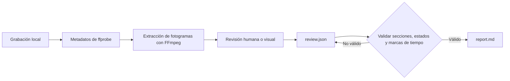

<div align="center">

# rea-game

Analiza cualquier vídeo de juego a la inversa y pasa de la grabación a un prototipo jugable.

**Convierte vídeos de juego en pruebas con marcas de tiempo, un análisis claro de sus mecánicas y un plan práctico para crear una recreación jugable.**

rea-game combina una CLI de Python con un flujo de revisión. FFmpeg extrae fotogramas, una persona o un asistente con capacidad visual examina la grabación y la CLI valida la revisión y genera un informe Markdown.

Software gratuito y de código abierto bajo la [licencia MIT](../LICENSE).


[Casos de juego](#casos-de-juego) · [Por qué usarlo](#por-qué-usarlo) · [Inicio rápido](#inicio-rápido) · [Ejemplo](#prueba-el-ejemplo) · [Formato de revisión](#formato-de-revisión) · [Cómo funciona](#cómo-funciona) · [Preguntas frecuentes](#preguntas-frecuentes)


</div>

[中文](README_zh.md) | [English](../README.md) | [Русский](README_ru.md) | [日本語](README_ja.md) | [한국어](README_ko.md) | [Español](README_es.md) | [Português](README_pt.md) | [Français](README_fr.md) | [Deutsch](README_de.md)

> Cuando tengas el análisis, continúa hasta crear una recreación jugable. Si programas, puedes usar Claude Code o Codex, o elegir un flujo de desarrollo con [Unity](https://unity.com/), [Unreal Engine](https://www.unrealengine.com/) o [Godot](https://godotengine.org/). Si no programas, usa [Seele AI](https://www.seeles.ai) para el siguiente paso.

## Casos de juego

Cada caso incluye el vídeo original, una portada comprimida de 12 fotogramas (6 columnas × 2 filas), fotogramas de evidencia con marcas de tiempo, la revisión completa y un informe con una cronología detallada e hipótesis sobre el juego. Las observaciones se separan de las inferencias y de las mecánicas sin resolver.

### Phantom Blade Zero


[Ver Phantom Blade Zero](../assets/cases/Phantom%20Blade%20Zero.mp4) · [Leer el informe de análisis](../assets/cases/analysis/phantom-blade-zero/report.md) · [Evidencia](../assets/cases/analysis/phantom-blade-zero/evidence.json) · [Revisión](../assets/cases/analysis/phantom-blade-zero/review.json) · [Fotogramas extraídos](../assets/cases/analysis/phantom-blade-zero/frames/)

<video controls preload="none" width="720"><source src="../assets/cases/Phantom%20Blade%20Zero.mp4" type="video/mp4">Tu navegador no puede reproducir este vídeo. [Abrir el archivo de vídeo](../assets/cases/Phantom%20Blade%20Zero.mp4).</video>

### Three Kingdoms Tactics


[Ver Three Kingdoms Tactics](../assets/cases/Three%20Kingdoms%20Tactics.mp4) · [Leer el informe de análisis](../assets/cases/analysis/three-kingdoms-tactics/report.md) · [Evidencia](../assets/cases/analysis/three-kingdoms-tactics/evidence.json) · [Revisión](../assets/cases/analysis/three-kingdoms-tactics/review.json) · [Fotogramas extraídos](../assets/cases/analysis/three-kingdoms-tactics/frames/)

<video controls preload="none" width="720"><source src="../assets/cases/Three%20Kingdoms%20Tactics.mp4" type="video/mp4">Tu navegador no puede reproducir este vídeo. [Abrir el archivo de vídeo](../assets/cases/Three%20Kingdoms%20Tactics.mp4).</video>

### Identity V


[Ver Identity V](../assets/cases/Identity%20V.mp4) · [Leer el informe de análisis](../assets/cases/analysis/identity-v/report.md) · [Evidencia](../assets/cases/analysis/identity-v/evidence.json) · [Revisión](../assets/cases/analysis/identity-v/review.json) · [Fotogramas extraídos](../assets/cases/analysis/identity-v/frames/)

<video controls preload="none" width="720"><source src="../assets/cases/Identity%20V.mp4" type="video/mp4">Tu navegador no puede reproducir este vídeo. [Abrir el archivo de vídeo](../assets/cases/Identity%20V.mp4).</video>

## Por qué usarlo

Al analizar una grabación, es fácil confundir lo que ves, lo que crees que significa y lo que todavía tienes que comprobar. rea-game los mantiene separados. Las observaciones y las inferencias deben incluir marcas de tiempo para que los lectores puedan revisar la evidencia.

Úsalo para estudiar un juego de referencia antes de crear un prototipo, organizar notas de pruebas de juego o proporcionar un proceso de revisión uniforme a un asistente con capacidad visual.

## Inicio rápido

### 1. Instala las herramientas

Necesitas Python 3.10 o posterior, FFmpeg y ffprobe. En la página del repositorio, elige **Code → Download ZIP** o clónalo con la URL que aparece en **Code**. Abre un terminal en la raíz del repositorio descargado o clonado, donde está <code>pyproject.toml</code>, e instala desde el código fuente siguiendo los pasos siguientes. El proyecto aún no está disponible en PyPI, así que <code>pip install rea-game</code> no funciona.

#### macOS (Terminal)

Instala primero [Homebrew](https://brew.sh/) y luego Python y FFmpeg:

```sh
brew install python@3.14 ffmpeg
python3.14 --version
ffmpeg -version
ffprobe -version
```

Crea y activa un entorno virtual e instala rea-game desde la raíz del repositorio:

```sh
python3.14 -m venv .venv
source .venv/bin/activate
python -m pip install .
rea-game --help
rea-game skill
```

Cada vez que abras otro terminal, vuelve a la raíz del repositorio y ejecuta de nuevo <code>source .venv/bin/activate</code>.

#### Windows 10/11 (PowerShell)

Instala Python y FFmpeg con [WinGet](https://learn.microsoft.com/windows/package-manager/winget/):

```powershell
winget install --id Python.Python.3.14 --exact
winget install --id Gyan.FFmpeg --exact
```

Cierra y vuelve a abrir PowerShell para aplicar los cambios del PATH. Ve a la raíz del repositorio y ejecuta:

```powershell
$env:PYTHONUTF8 = "1"
py -3.14 --version
ffmpeg -version
ffprobe -version
py -3.14 -m venv .venv
.\.venv\Scripts\python.exe -m pip install .
.\.venv\Scripts\rea-game.exe --help
.\.venv\Scripts\rea-game.exe skill
```

Los ejemplos de Windows llaman directamente a los ejecutables del entorno virtual, por lo que no hace falta activar un script ni cambiar la directiva de ejecución de PowerShell. Define <code>$env:PYTHONUTF8 = "1"</code> en cada sesión nueva de PowerShell para usar UTF-8 de forma coherente también con versiones antiguas de Python.

Si no tienes WinGet, instala Python 3.14 desde [python.org](https://www.python.org/downloads/windows/). Si usas el administrador de instalaciones de Python, ejecuta primero <code>py install 3.14</code>. Descarga una compilación de Windows desde la [página de FFmpeg](https://ffmpeg.org/download.html) y añade a tu PATH de usuario el directorio <code>bin</code>, que contiene <code>ffmpeg.exe</code> y <code>ffprobe.exe</code>. Abre PowerShell de nuevo y comprueba las versiones; ambos comandos deben estar disponibles en el terminal.

#### Linux (Ubuntu/Debian)

Instala Python, el soporte de entornos virtuales y FFmpeg con <code>apt</code>:

```sh
sudo apt update
sudo apt install python3 python3-venv ffmpeg
python3 --version
ffmpeg -version
ffprobe -version
```

Comprueba que <code>python3 --version</code> indique Python 3.10 o posterior. Después crea y activa un entorno virtual e instala rea-game desde la raíz del repositorio:

```sh
python3 -m venv .venv
source .venv/bin/activate
python -m pip install .
rea-game --help
rea-game skill
```

### 2. Extrae fotogramas y revisa el vídeo

macOS / Linux, con el entorno virtual activado:

```sh
rea-game extract "/path/to/gameplay.mp4" -o out/my-game --interval 3
```

Windows PowerShell:

```powershell
.\.venv\Scripts\rea-game.exe extract "C:\Videos\gameplay.mp4" -o out/my-game --interval 3
```

Sustituye la ruta por la de tu vídeo. Mantén las comillas cuando la ruta contenga espacios. <code>--interval</code> es el número de segundos entre fotogramas y su valor predeterminado es 5. Debe ser un número finito mayor que cero. Se rechazan los intervalos que desbordan el recuento de fotogramas.

Si el archivo tiene varias pistas de vídeo, rea-game usa la primera que no sea una imagen de portada. Las dimensiones de los fotogramas, la duración cuando está disponible en la pista y las imágenes extraídas corresponden a esa pista.

El comando crea un directorio nuevo:

```text
out/my-game/
├── evidence.json   # Origen, duración, dimensiones, audio y marcas de tiempo de los fotogramas
├── frames/         # Fotogramas JPEG extraídos
└── review.json     # Plantilla de revisión para completar
```

Examina los fotogramas y luego reproduce el vídeo original alrededor de los momentos importantes para comprobar qué ocurre entre ellos. Escucha el audio antes de hacer afirmaciones sobre el sonido. Las marcas de tiempo indican posiciones de búsqueda solicitadas; los fotogramas decodificados pueden variar ligeramente.

### 3. Genera un informe

Abre <code>out/my-game/review.json</code> en un editor de texto, añade tus hallazgos según el [formato de revisión](#formato-de-revisión) y guarda el archivo en UTF-8. El idioma predeterminado para redactar es el inglés. Después ejecuta:

macOS / Linux:

```sh
rea-game report out/my-game
```

Windows PowerShell:

```powershell
.\.venv\Scripts\rea-game.exe report out/my-game
```

El informe se guarda en <code>out/my-game/report.md</code>. Incluye el ciclo de juego, los controles, las reglas, la progresión, la interfaz, el arte, el sonido, un plan para el prototipo y preguntas abiertas; también sugiere los siguientes pasos para avanzar hacia una recreación jugable. Las secciones vacías muestran “Not yet reviewed.”

## Prueba el ejemplo

El repositorio incluye un generador de un vídeo sintético de tres segundos: un cuadrado blanco sobre fondo negro cambia de posición al llegar al segundo uno. Permite probar la extracción y la generación de informes sin descargar recursos del juego, aunque no es un ejemplo completo de juego.

| 0 segundos | 1 segundo |
| --- | --- |
|  |  |

Ejecuta los comandos desde la raíz del repositorio. En macOS / Linux, activa primero el entorno virtual:

```sh
python examples/synthetic/create_video.py out/synthetic.mp4
rea-game extract out/synthetic.mp4 -o out/synthetic --interval 1
cp examples/synthetic/review.json out/synthetic/review.json
rea-game report out/synthetic
```

Windows PowerShell:

```powershell
$env:PYTHONUTF8 = "1"
.\.venv\Scripts\python.exe examples/synthetic/create_video.py out/synthetic.mp4
.\.venv\Scripts\rea-game.exe extract out/synthetic.mp4 -o out/synthetic --interval 1
Copy-Item examples/synthetic/review.json out/synthetic/review.json
.\.venv\Scripts\rea-game.exe report out/synthetic
```

Antes de copiar la revisión de ejemplo, inspecciona los fotogramas y reproduce el vídeo para verificar el movimiento. Cuando vuelvas a ejecutar el ejemplo, usa otra ruta de vídeo y otro directorio de salida.

Consulta el [informe de ejemplo](../examples/synthetic/report.md), el [archivo de revisión](../examples/synthetic/review.json) y la [guía paso a paso](../examples/synthetic/README.md). El informe de ejemplo usa <code>out/synthetic.mp4</code> como ruta de origen; el informe generado por ti registrará la ruta local real.

## Formato de revisión

Cada sección contiene una matriz de entradas. Todas requieren <code>text</code> y <code>status</code>. <code>times</code> es opcional, salvo para observaciones e inferencias, que deben citar al menos una marca de tiempo dentro de la grabación:

```json
{
  "core_loop": [
    {
      "text": "The counter increases when the character touches an item.",
      "status": "observation",
      "times": [12.3]
    }
  ],
  "unknowns": [
    {
      "text": "Do collected items respawn after a delay?",
      "status": "unverified",
      "times": []
    }
  ],
  "remake": [
    {
      "text": "Start with movement, item collection, and an on-screen counter.",
      "status": "proposal",
      "times": []
    }
  ]
}
```

Son ejemplos del formato, no conclusiones sobre tu vídeo. Conserva las claves de sección de la plantilla generada. Se rechazan las secciones y los campos desconocidos para detectar errores tipográficos.

| Estado | Uso | Marcas de tiempo |
| --- | --- | --- |
| <code>observation</code> | Algo que se ve o se oye directamente en la grabación | Obligatoria |
| <code>inference</code> | Interpretación respaldada por evidencia pero aún sin confirmar | Obligatoria |
| <code>unverified</code> | Pregunta o afirmación que el vídeo no permite resolver | Opcional |
| <code>proposal</code> | Enfoque sugerido para crear un prototipo | Opcional |

El plan del prototipo debe indicar la versión jugable más pequeña, las mecánicas principales, las escenas y los recursos necesarios y el orden de implementación. Por lo general, el vídeo no permite determinar las asignaciones de entrada, los valores ocultos, todas las condiciones de victoria o derrota ni la tecnología original. Deja claras esas incertidumbres.

## Cómo funciona



La CLI usa la biblioteca estándar de Python para los argumentos, JSON, archivos y subprocesos. FFmpeg se encarga de decodificar el vídeo. Los datos de revisión son JSON legible y los informes son Markdown normal. Para ejecutar la herramienta instalada no se necesita ningún modelo, clave de API ni conexión de red. Si usas un asistente en la nube, su flujo de trabajo determina si se sube el vídeo.

Antes de generar un informe, rea-game comprueba:

- Que <code>evidence.json</code> tenga un origen no vacío, una duración positiva y finita y un índice de fotograma válido.
- Que <code>review.json</code> use nombres de sección y campos de entrada conocidos.
- Que los estados sean válidos, el texto no esté vacío y las marcas de tiempo sean finitas y estén dentro de la grabación. Las observaciones y las inferencias deben incluir marcas de tiempo.

Para proteger las revisiones existentes, la extracción requiere un directorio de salida nuevo. Si falla, se elimina el directorio creado por esa ejecución para que puedas intentarlo de nuevo. Generar un informe sobrescribe <code>report.md</code> en el directorio seleccionado.

## Pruebas y paquetes

Las pruebas cubren el flujo completo de FFmpeg al informe, la coherencia entre varias pistas de vídeo, intervalos pequeños, JSON no válido, validación de campos, límites de marcas de tiempo y limpieza después de una extracción fallida. CI está configurada para Python 3.10 y 3.14 en Linux, macOS y Windows. Ejecuta las pruebas, crea un wheel y una distribución de código fuente e instala cada paquete en un entorno aislado para ejecutar el ejemplo. No publica paquetes. Consulta las ejecuciones de Actions del repositorio para ver los resultados.

Consulta [CONTRIBUTING.md](../CONTRIBUTING.md) para las comprobaciones de desarrollo y publicación.

## Preguntas frecuentes

<details>
<summary>¿rea-game es gratuito?</summary>

Sí. rea-game es software de código abierto publicado bajo la licencia MIT. La CLI no tiene suscripción, clave de API ni cuota de uso. Los asistentes de IA o servicios de desarrollo de pago que elijas son independientes.

</details>

<details>
<summary>¿Qué hace rea-game?</summary>

rea-game convierte vídeos de juego en informes estructurados y basados en evidencia que sirven de apoyo para desarrollar prototipos. Extrae fotogramas con marcas de tiempo, ofrece un flujo de revisión de juego, controles, reglas, progresión, interfaz, arte y audio, valida la revisión y crea un informe Markdown con un plan de prototipo y preguntas abiertas.

</details>

<details>
<summary>¿rea-game analiza el vídeo automáticamente?</summary>

No. La CLI extrae fotogramas y genera un informe a partir de tu revisión; no entiende el juego por sí sola. Una persona o un asistente con capacidad visual debe examinar los fotogramas y los segmentos relevantes del vídeo y añadir el análisis. Marca como no verificados los detalles que la grabación no pueda confirmar, en vez de tratar una suposición como una regla comprobada.

</details>

<details>
<summary>¿Para qué sirve el informe de análisis?</summary>

Sirve para entender y comunicar el ciclo de juego visible, las interacciones, las respuestas del juego y las mecánicas sin resolver. El plan de prototipo convierte los hallazgos en un alcance inicial, mecánicas principales, escenas y recursos sugeridos, opciones tecnológicas y un orden de implementación. Es una entrega práctica para planificar una recreación jugable, no una especificación completa del juego.

</details>

<details>
<summary>¿Puedo crear un juego jugable a partir del informe?</summary>

El informe ofrece un punto de partida fundamentado, no código ni recursos de juego terminados. Si programas, puedes continuar con Claude Code o Codex, o desarrollar con [Unity](https://unity.com/), [Unreal Engine](https://www.unrealengine.com/) o [Godot](https://godotengine.org/). Si no programas, usa [Seele AI](https://www.seeles.ai) para el siguiente paso.

</details>

<details>
<summary>¿Necesito saber programar para usar rea-game?</summary>

No necesitas experiencia en desarrollo de juegos, pero rea-game es un flujo local de línea de comandos, no un servicio web de un solo clic. Tendrás que instalar Python y FFmpeg, ejecutar algunos comandos y añadir los hallazgos a <code>review.json</code>. Puedes revisar el vídeo por tu cuenta o pedir ayuda a un asistente con capacidad visual. El informe te ayudará a elegir un camino de desarrollo adecuado para tus habilidades.

</details>

<details>
<summary>¿Qué tipo de vídeo debería analizar?</summary>

Usa una grabación que muestre las acciones del jugador y la respuesta correspondiente en pantalla. Un clip corto puede explicar una interacción concreta; una grabación larga que incluya un ciclo de juego completo aporta más contexto. Si faltan controles, resultados o transiciones, anótalos como preguntas abiertas.

</details>

<details>
<summary>¿El vídeo sale de mi ordenador?</summary>

La CLI procesa un archivo de vídeo local y no requiere modelo, clave de API ni conexión de red. Si pides a un asistente en la nube que revise la grabación, la subida dependerá de su flujo de trabajo y su configuración.

</details>

<details>
<summary>¿Por qué la extracción requiere un directorio nuevo?</summary>

Para proteger el trabajo de revisión existente. Tú gestionas los directorios de salida creados correctamente; si falla la extracción, solo se elimina el directorio creado por esa ejecución.

</details>

<details>
<summary>¿Puedo escribir las entradas de revisión en otro idioma?</summary>

Sí. El inglés es el idioma predeterminado de la CLI, los títulos de los informes, los ejemplos y el flujo de trabajo del asistente. El informe conserva el texto que introduzcas, pero no lo traduce. Los estados siempre deben ser <code>observation</code>, <code>inference</code>, <code>unverified</code> o <code>proposal</code>.

</details>

<details>
<summary>¿Qué debo comprobar antes de compartir un informe?</summary>

El informe y <code>evidence.json</code> contienen la ruta local del vídeo. Antes de compartirlos, comprueba si hay rutas privadas y asegúrate de tener permiso para usar el vídeo, las capturas, la música y los recursos del juego. La licencia MIT del repositorio no concede derechos sobre contenido de terceros.

</details>

## Colabora

Se agradecen los informes de errores, las sugerencias y las solicitudes de cambios. Consulta la [guía de contribución](../CONTRIBUTING.md) para la configuración, los informes de problemas y las comprobaciones de publicación.

macOS / Linux, con el entorno virtual activado:

```sh
python -m unittest discover -s tests
```

Windows PowerShell:

```powershell
$env:PYTHONUTF8 = "1"
.\.venv\Scripts\python.exe -m unittest discover -s tests
```

## Créditos y licencia

Inspirado por REA (Reverse Engineer Anything): seguir lo que ves hasta descubrir cómo se hizo, respaldar cada afirmación con evidencia y verificar mediante mediciones.

El código y el ejemplo sintético original se distribuyen bajo la [licencia MIT](../LICENSE). Consulta el [flujo de revisión](../rea_game/SKILL.md) y el [registro de cambios](../CHANGELOG.md) para obtener más información.
