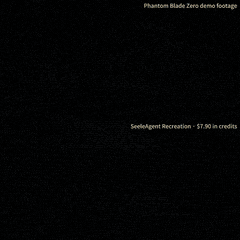
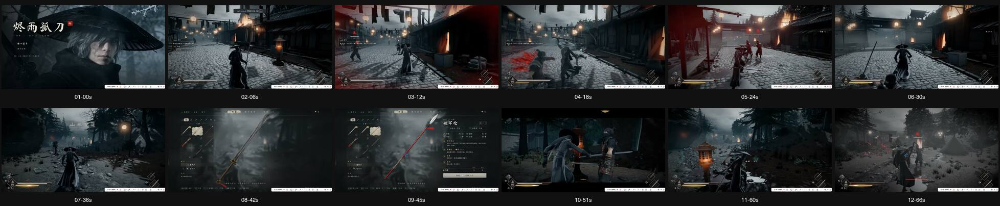
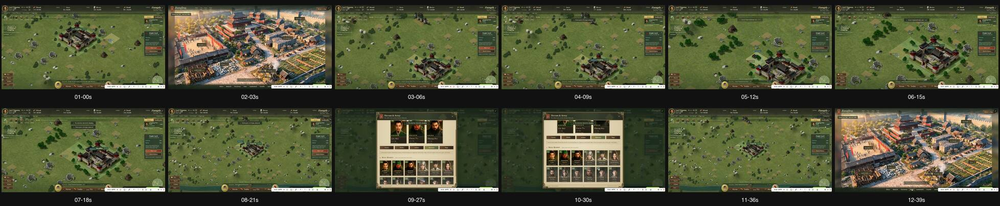
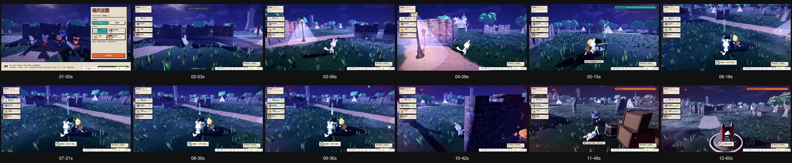
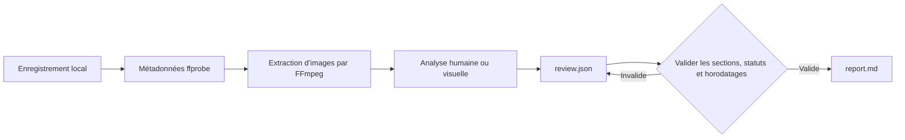

<div align="center">

# rea-game

Analysez n’importe quelle vidéo de jeu pour remonter de la séquence à un prototype jouable.

**Transformez des vidéos de jeu en preuves horodatées, en analyse claire de leurs mécaniques et en plan pratique pour créer une version jouable.**

rea-game associe une CLI Python à un processus d’analyse. FFmpeg extrait les images, une personne ou un assistant doté de capacités visuelles examine la séquence, puis la CLI valide l’analyse et génère un rapport Markdown.

Logiciel libre et gratuit sous [licence MIT](../LICENSE).



[Exemples de jeux](#exemples-de-jeux) · [Pourquoi l’utiliser](#pourquoi-lutiliser) · [Démarrage rapide](#démarrage-rapide) · [Exemple](#essayer-lexemple) · [Format de l’analyse](#format-de-lanalyse) · [Fonctionnement](#fonctionnement) · [FAQ](#questions-fréquentes)


</div>

[中文](README_zh.md) | [English](../README.md) | [Русский](README_ru.md) | [日本語](README_ja.md) | [한국어](README_ko.md) | [Español](README_es.md) | [Português](README_pt.md) | [Français](README_fr.md) | [Deutsch](README_de.md)

> Après l’analyse, poursuivez jusqu’à la création d’une version jouable. Si vous savez programmer, utilisez Claude Code ou Codex, ou choisissez un processus de développement avec [Unity](https://unity.com/), [Unreal Engine](https://www.unrealengine.com/) ou [Godot](https://godotengine.org/). Si vous ne programmez pas, utilisez [Seele AI](https://www.seeles.ai) pour continuer.

## Exemples de jeux

Chaque exemple comprend la vidéo source, une couverture compressée de 12 images (6 colonnes × 2 lignes), les images de preuve horodatées, l’analyse remplie et un rapport avec une chronologie détaillée et des hypothèses de jeu. Les observations sont distinguées des déductions et des mécaniques non résolues.

### Phantom Blade Zero



[Voir Phantom Blade Zero](../assets/cases/Phantom%20Blade%20Zero.mp4) · [Lire le rapport d’analyse](../assets/cases/analysis/phantom-blade-zero/report.md) · [Preuves](../assets/cases/analysis/phantom-blade-zero/evidence.json) · [Analyse](../assets/cases/analysis/phantom-blade-zero/review.json) · [Images extraites](../assets/cases/analysis/phantom-blade-zero/frames/)

<video controls preload="none" width="720"><source src="../assets/cases/Phantom%20Blade%20Zero.mp4" type="video/mp4">Votre navigateur ne peut pas lire cette vidéo. [Ouvrir le fichier vidéo](../assets/cases/Phantom%20Blade%20Zero.mp4).</video>

### Three Kingdoms Tactics



[Voir Three Kingdoms Tactics](../assets/cases/Three%20Kingdoms%20Tactics.mp4) · [Lire le rapport d’analyse](../assets/cases/analysis/three-kingdoms-tactics/report.md) · [Preuves](../assets/cases/analysis/three-kingdoms-tactics/evidence.json) · [Analyse](../assets/cases/analysis/three-kingdoms-tactics/review.json) · [Images extraites](../assets/cases/analysis/three-kingdoms-tactics/frames/)

<video controls preload="none" width="720"><source src="../assets/cases/Three%20Kingdoms%20Tactics.mp4" type="video/mp4">Votre navigateur ne peut pas lire cette vidéo. [Ouvrir le fichier vidéo](../assets/cases/Three%20Kingdoms%20Tactics.mp4).</video>

### Identity V



[Voir Identity V](../assets/cases/Identity%20V.mp4) · [Lire le rapport d’analyse](../assets/cases/analysis/identity-v/report.md) · [Preuves](../assets/cases/analysis/identity-v/evidence.json) · [Analyse](../assets/cases/analysis/identity-v/review.json) · [Images extraites](../assets/cases/analysis/identity-v/frames/)

<video controls preload="none" width="720"><source src="../assets/cases/Identity%20V.mp4" type="video/mp4">Votre navigateur ne peut pas lire cette vidéo. [Ouvrir le fichier vidéo](../assets/cases/Identity%20V.mp4).</video>

## Pourquoi l’utiliser

Lorsqu’on analyse une séquence de jeu, on peut facilement confondre ce qu’on voit, ce qu’on pense que cela signifie et ce qu’il reste à vérifier. rea-game sépare ces éléments. Les observations et les déductions doivent citer des horodatages pour que les lecteurs puissent revenir aux preuves.

Utilisez l’outil pour étudier un jeu de référence avant de créer un prototype, organiser des notes de test ou fournir un processus d’analyse cohérent à un assistant doté de capacités visuelles.

## Démarrage rapide

### 1. Installer les outils

Vous avez besoin de Python 3.10 ou version ultérieure, de FFmpeg et de ffprobe. Sur la page du dépôt, choisissez **Code → Download ZIP** ou clonez-le avec l’URL affichée sous **Code**. Ouvrez un terminal à la racine du dépôt téléchargé ou cloné, là où se trouve <code>pyproject.toml</code>, puis installez depuis les sources avec les étapes ci-dessous. Le projet n’est pas encore publié sur PyPI ; <code>pip install rea-game</code> n’est donc pas disponible.

#### macOS (Terminal)

Installez d’abord [Homebrew](https://brew.sh/), puis Python et FFmpeg :

```sh
brew install python@3.14 ffmpeg
python3.14 --version
ffmpeg -version
ffprobe -version
```

Créez et activez un environnement virtuel, puis installez rea-game depuis la racine du dépôt :

```sh
python3.14 -m venv .venv
source .venv/bin/activate
python -m pip install .
rea-game --help
rea-game skill
```

À chaque nouveau terminal, revenez à la racine du dépôt et exécutez à nouveau <code>source .venv/bin/activate</code>.

#### Windows 10/11 (PowerShell)

Installez Python et FFmpeg avec [WinGet](https://learn.microsoft.com/windows/package-manager/winget/) :

```powershell
winget install --id Python.Python.3.14 --exact
winget install --id Gyan.FFmpeg --exact
```

Fermez puis rouvrez PowerShell pour appliquer les modifications du PATH. Revenez à la racine du dépôt et exécutez :

```powershell
$env:PYTHONUTF8 = "1"
py -3.14 --version
ffmpeg -version
ffprobe -version
py -3.14 -m venv .venv
.\.venv\Scripts\python.exe -m pip install .
.\.venv\Scripts\rea-game.exe --help
.\.venv\Scripts\rea-game.exe skill
```

Les exemples Windows appellent directement les exécutables de l’environnement virtuel : il n’est pas nécessaire d’activer un script ni de modifier la stratégie d’exécution de PowerShell. Dans chaque nouvelle session PowerShell, définissez <code>$env:PYTHONUTF8 = "1"</code> pour utiliser UTF-8 de façon cohérente avec les anciennes versions de Python.

Si WinGet n’est pas disponible, installez Python 3.14 depuis [python.org](https://www.python.org/downloads/windows/). Avec le gestionnaire d’installation Python, exécutez d’abord <code>py install 3.14</code>. Téléchargez une version Windows sur la [page de téléchargement de FFmpeg](https://ffmpeg.org/download.html), puis ajoutez au PATH utilisateur le dossier <code>bin</code>, qui contient <code>ffmpeg.exe</code> et <code>ffprobe.exe</code>. Rouvrez PowerShell et vérifiez les versions ; les deux commandes doivent être accessibles depuis le terminal.

#### Linux (Ubuntu/Debian)

Installez Python, la prise en charge des environnements virtuels et FFmpeg avec <code>apt</code> :

```sh
sudo apt update
sudo apt install python3 python3-venv ffmpeg
python3 --version
ffmpeg -version
ffprobe -version
```

Vérifiez que <code>python3 --version</code> indique Python 3.10 ou version ultérieure. Créez et activez ensuite un environnement virtuel, puis installez rea-game depuis la racine du dépôt :

```sh
python3 -m venv .venv
source .venv/bin/activate
python -m pip install .
rea-game --help
rea-game skill
```

### 2. Extraire des images et examiner la vidéo

macOS / Linux, avec l’environnement virtuel activé :

```sh
rea-game extract "/path/to/gameplay.mp4" -o out/my-game --interval 3
```

Windows PowerShell :

```powershell
.\.venv\Scripts\rea-game.exe extract "C:\Videos\gameplay.mp4" -o out/my-game --interval 3
```

Remplacez le chemin par celui de votre vidéo. Gardez les guillemets si le chemin contient des espaces. <code>--interval</code> définit le nombre de secondes entre les images et vaut 5 par défaut. Il doit s’agir d’un nombre fini supérieur à zéro. Les intervalles susceptibles de faire déborder le nombre d’images sont refusés.

Si le fichier contient plusieurs pistes vidéo, rea-game utilise la première qui n’est pas une image de couverture. Les dimensions des images, la durée lorsqu’elle est disponible sur la piste et les images extraites proviennent de cette piste.

La commande crée un nouveau dossier :

```text
out/my-game/
├── evidence.json   # Source, durée, dimensions, présence audio et horodatages des images
├── frames/         # Images JPEG extraites
└── review.json     # Modèle d’analyse à remplir
```

Examinez les images, puis regardez la vidéo originale autour des moments importants pour vérifier ce qui se passe entre elles. Écoutez l’audio avant de formuler des affirmations sur le son. Les horodatages indiquent les positions de recherche demandées ; les images décodées peuvent légèrement différer.

### 3. Générer un rapport

Ouvrez <code>out/my-game/review.json</code> dans un éditeur de texte, ajoutez vos observations selon le [format de l’analyse](#format-de-lanalyse) et enregistrez en UTF-8. La langue de rédaction par défaut est l’anglais. Lancez ensuite :

macOS / Linux :

```sh
rea-game report out/my-game
```

Windows PowerShell :

```powershell
.\.venv\Scripts\rea-game.exe report out/my-game
```

Le rapport est enregistré dans <code>out/my-game/report.md</code>. Il traite de la boucle de jeu, des commandes, des règles, de la progression, de l’interface, de l’art, du son, du plan de prototype et des questions ouvertes, puis suggère les prochaines étapes vers une version jouable. Les sections vides affichent “Not yet reviewed.”

## Essayer l’exemple

Le dépôt contient un générateur de vidéo synthétique de trois secondes : un carré blanc sur fond noir change de position à la première seconde. Il illustre l’extraction et la génération de rapport sans télécharger d’éléments de jeu, mais ne constitue pas un exemple complet de gameplay.

| 0 seconde | 1 seconde |
| --- | --- |
|  |  |

Lancez les commandes depuis la racine du dépôt. Sur macOS / Linux, activez d’abord l’environnement virtuel :

```sh
python examples/synthetic/create_video.py out/synthetic.mp4
rea-game extract out/synthetic.mp4 -o out/synthetic --interval 1
cp examples/synthetic/review.json out/synthetic/review.json
rea-game report out/synthetic
```

Windows PowerShell :

```powershell
$env:PYTHONUTF8 = "1"
.\.venv\Scripts\python.exe examples/synthetic/create_video.py out/synthetic.mp4
.\.venv\Scripts\rea-game.exe extract out/synthetic.mp4 -o out/synthetic --interval 1
Copy-Item examples/synthetic/review.json out/synthetic/review.json
.\.venv\Scripts\rea-game.exe report out/synthetic
```

Avant de copier l’analyse d’exemple, examinez les images et lisez la vidéo pour confirmer le déplacement. Pour relancer l’exemple, utilisez un nouveau chemin vidéo et un nouveau dossier de sortie.

Voir le [rapport d’exemple](../examples/synthetic/report.md), le [fichier d’analyse](../examples/synthetic/review.json) et le [guide étape par étape](../examples/synthetic/README.md). Le rapport d’exemple indique <code>out/synthetic.mp4</code> comme source ; le rapport généré par vos soins enregistre le chemin local réel.

## Format de l’analyse

Chaque section contient une liste d’entrées. Chaque entrée doit comporter <code>text</code> et <code>status</code>. <code>times</code> est facultatif, sauf pour les observations et les déductions, qui doivent citer au moins un horodatage dans la durée de l’enregistrement :

```json
{
  "core_loop": [
    {
      "text": "The counter increases when the character touches an item.",
      "status": "observation",
      "times": [12.3]
    }
  ],
  "unknowns": [
    {
      "text": "Do collected items respawn after a delay?",
      "status": "unverified",
      "times": []
    }
  ],
  "remake": [
    {
      "text": "Start with movement, item collection, and an on-screen counter.",
      "status": "proposal",
      "times": []
    }
  ]
}
```

Ces exemples illustrent le format et ne constituent pas des conclusions sur votre vidéo. Conservez les clés de section du modèle généré. Les sections et champs inconnus sont refusés afin de détecter les fautes de frappe.

| Statut | Utilisation | Horodatages |
| --- | --- | --- |
| <code>observation</code> | Élément directement visible ou audible dans l’enregistrement | Obligatoire |
| <code>inference</code> | Interprétation étayée par des preuves, mais pas encore confirmée | Obligatoire |
| <code>unverified</code> | Question ou affirmation que la vidéo ne permet pas de trancher | Facultatifs |
| <code>proposal</code> | Approche suggérée pour créer un prototype | Facultatifs |

Un plan de prototype doit préciser la plus petite version jouable, les mécaniques principales, les scènes et ressources requises ainsi que l’ordre de réalisation. Une vidéo seule ne permet généralement pas d’établir les commandes, les valeurs cachées, toutes les conditions de victoire ou de défaite ni la technologie d’origine. Indiquez clairement ces incertitudes.

## Fonctionnement



La CLI utilise la bibliothèque standard de Python pour les arguments, JSON, fichiers et sous-processus. FFmpeg décode la vidéo. Les analyses sont stockées en JSON lisible et les rapports sont en Markdown brut. L’outil installé ne nécessite ni modèle, ni clé API, ni connexion réseau. Si vous utilisez un assistant cloud, son processus détermine si la vidéo est téléversée.

Avant de générer un rapport, rea-game vérifie :

- La présence d’une source non vide, d’une durée finie et positive et d’un index d’image valide dans <code>evidence.json</code>.
- L’utilisation de noms de sections et de champs d’entrée connus dans <code>review.json</code>.
- La validité des statuts, le caractère non vide du texte et la présence d’horodatages finis dans la durée de l’enregistrement. Les observations et les déductions doivent être horodatées.

Pour protéger les analyses existantes, l’extraction exige un nouveau dossier de sortie. En cas d’échec, le dossier créé par cette exécution est supprimé pour permettre une nouvelle tentative. La génération d’un rapport remplace <code>report.md</code> dans le dossier choisi.

## Tests et packages

Les tests couvrent le flux complet de FFmpeg au rapport, la cohérence entre plusieurs pistes vidéo, les intervalles très courts, le JSON invalide, la validation des champs, les limites d’horodatage et le nettoyage après un échec d’extraction. La CI cible Python 3.10 et 3.14 sur Linux, macOS et Windows. Elle exécute les tests, crée un wheel et une distribution source, puis installe chaque package dans un environnement isolé pour lancer l’exemple. Elle ne publie pas les packages. Consultez les exécutions Actions du dépôt pour connaître les résultats réels.

Voir [CONTRIBUTING.md](../CONTRIBUTING.md) pour les vérifications de développement et de publication.

## Questions fréquentes

<details>
<summary>rea-game est-il gratuit ?</summary>

Oui. rea-game est un logiciel libre publié sous licence MIT. La CLI n’exige aucun abonnement, aucune clé API et aucuns frais d’utilisation. Les assistants IA ou services de développement payants que vous choisissez sont indépendants.

</details>

<details>
<summary>Que fait rea-game ?</summary>

rea-game transforme des vidéos de jeu en rapports d’analyse structurés et fondés sur des preuves, utiles au développement de prototypes. Il extrait des images horodatées, propose un processus d’analyse du gameplay, des commandes, des règles, de la progression, de l’interface, de l’art et du son, valide l’analyse et génère un rapport Markdown avec un plan de prototype et des questions ouvertes.

</details>

<details>
<summary>rea-game analyse-t-il la vidéo automatiquement ?</summary>

Non. La CLI extrait les images et génère un rapport à partir de votre analyse ; elle ne comprend pas le gameplay elle-même. Une personne ou un assistant doté de capacités visuelles doit examiner les images et les segments pertinents, puis ajouter l’analyse. Marquez comme non vérifiés les détails que la vidéo ne permet pas de confirmer, au lieu de présenter une supposition comme une règle établie.

</details>

<details>
<summary>À quoi sert le rapport d’analyse ?</summary>

Il permet de comprendre et de communiquer la boucle de jeu visible, les interactions, les réactions et les mécaniques non résolues. Le plan de prototype transforme les observations en périmètre initial, mécaniques principales, scènes et ressources suggérées, options technologiques et ordre de réalisation. Il sert de passation pratique pour planifier une version jouable, mais ne constitue pas une spécification complète du jeu.

</details>

<details>
<summary>Puis-je créer un jeu jouable à partir du rapport ?</summary>

Le rapport fournit un point de départ étayé, pas du code ni des ressources de jeu terminés. Si vous savez programmer, poursuivez avec Claude Code ou Codex, ou développez avec [Unity](https://unity.com/), [Unreal Engine](https://www.unrealengine.com/) ou [Godot](https://godotengine.org/). Si vous ne programmez pas, utilisez [Seele AI](https://www.seeles.ai) pour continuer.

</details>

<details>
<summary>Faut-il savoir programmer pour utiliser rea-game ?</summary>

Aucune compétence en développement de jeux n’est nécessaire, mais rea-game est un processus local en ligne de commande, pas un service Web en un clic. Vous devez installer Python et FFmpeg, exécuter quelques commandes et ajouter vos observations à <code>review.json</code>. Vous pouvez examiner la vidéo vous-même ou demander l’aide d’un assistant visuel. Le rapport vous aidera ensuite à choisir une voie de développement adaptée à vos compétences.

</details>

<details>
<summary>Quel type de vidéo dois-je analyser ?</summary>

Utilisez une séquence montrant les actions du joueur et les réactions correspondantes à l’écran. Un court extrait peut expliquer une interaction précise ; un enregistrement plus long comprenant une boucle complète apporte davantage de contexte. Si les commandes, résultats ou transitions ne sont pas visibles, consignez-les comme questions ouvertes.

</details>

<details>
<summary>Ma vidéo quitte-t-elle mon ordinateur ?</summary>

La CLI traite un fichier vidéo local et ne nécessite ni modèle, ni clé API, ni connexion réseau. Si vous demandez à un assistant cloud d’examiner votre vidéo, son téléversement dépend du processus et des paramètres de cet assistant.

</details>

<details>
<summary>Pourquoi l’extraction exige-t-elle un nouveau dossier ?</summary>

Pour protéger les analyses existantes. Vous gérez les dossiers de sortie créés avec succès ; un échec d’extraction ne supprime que le dossier créé par cette exécution.

</details>

<details>
<summary>Puis-je rédiger les analyses dans une autre langue ?</summary>

Oui. L’anglais est la langue par défaut de la CLI, des titres de rapport, des exemples et du processus de l’assistant. Le rapport conserve le texte saisi et ne le traduit pas. Les statuts doivent toujours être <code>observation</code>, <code>inference</code>, <code>unverified</code> ou <code>proposal</code>.

</details>

<details>
<summary>Que vérifier avant de partager un rapport ?</summary>

Le rapport et <code>evidence.json</code> indiquent le chemin local de la vidéo. Avant de les partager, vérifiez qu’il ne révèle pas d’informations privées et que vous avez le droit d’utiliser la vidéo, les captures d’écran, la musique et les ressources du jeu. La licence MIT du dépôt n’accorde aucun droit sur les contenus de jeux tiers.

</details>

## Contribuer

Les rapports de bugs, suggestions et pull requests sont les bienvenus. Consultez le [guide de contribution](../CONTRIBUTING.md) pour la configuration, le signalement de problèmes et les vérifications de publication.

macOS / Linux, avec l’environnement virtuel activé :

```sh
python -m unittest discover -s tests
```

Windows PowerShell :

```powershell
$env:PYTHONUTF8 = "1"
.\.venv\Scripts\python.exe -m unittest discover -s tests
```

## Remerciements et licence

Inspiré par REA (Reverse Engineer Anything) : remonter de ce que l’on voit à la façon dont cela a été réalisé, étayer chaque affirmation par des preuves et vérifier par la mesure.

Le code et l’exemple synthétique original sont disponibles sous [licence MIT](../LICENSE). Voir le [processus d’analyse](../rea_game/SKILL.md) et le [journal des modifications](../CHANGELOG.md) pour plus de détails.
