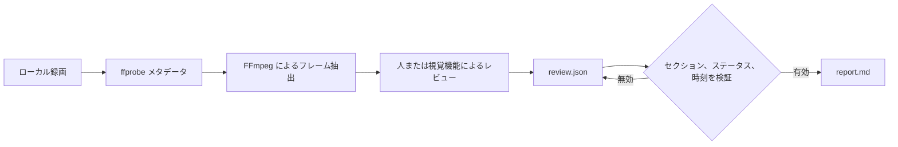

<div align="center">

# rea-game

ゲーム動画を逆解析し、プレイ可能なプロトタイプにつなげます。

**ゲーム動画を、タイムスタンプ付きの証拠、仕組みの明確な分析、プレイ可能な再現版を作るための実践的な計画に変換します。**

rea-game は Python の CLI とレビュー手順を組み合わせています。FFmpeg でフレームを抽出し、人または視覚機能を備えたアシスタントが映像を確認します。CLI はレビュー内容を検証し、Markdown レポートを生成します。

[MIT ライセンス](../LICENSE)で公開されている無料のオープンソースソフトウェアです。


[ゲーム事例](#ゲーム事例) · [利用する理由](#利用する理由) · [クイックスタート](#クイックスタート) · [サンプル](#サンプルを試す) · [レビュー形式](#レビュー形式) · [仕組み](#仕組み) · [FAQ](#よくある質問)


</div>

[中文](README_zh.md) | [English](../README.md) | [Русский](README_ru.md) | [日本語](README_ja.md) | [한국어](README_ko.md) | [Español](README_es.md) | [Português](README_pt.md) | [Français](README_fr.md) | [Deutsch](README_de.md)

> 分析が終わったら、プレイ可能な再現版の制作に進みましょう。プログラミングができる場合は Claude Code や Codex を使うか、[Unity](https://unity.com/)、[Unreal Engine](https://www.unrealengine.com/)、[Godot](https://godotengine.org/) などの開発環境を利用できます。プログラミングをしない場合は [Seele AI](https://www.seeles.ai) で次の開発段階に進めます。

## ゲーム事例

各事例には、元動画、12 フレームの縮小カバー画像（6 列 × 2 行）、タイムスタンプ付きの根拠フレーム、記入済みのレビュー、詳細なタイムラインとゲームプレイ仮説を含むレポートがあります。観察、推論、未解決の仕組みは区別されています。

### Phantom Blade Zero


[Phantom Blade Zero を見る](../assets/cases/Phantom%20Blade%20Zero.mp4) · [分析レポート](../assets/cases/analysis/phantom-blade-zero/report.md) · [根拠データ](../assets/cases/analysis/phantom-blade-zero/evidence.json) · [レビュー](../assets/cases/analysis/phantom-blade-zero/review.json) · [抽出フレーム](../assets/cases/analysis/phantom-blade-zero/frames/)

<video controls preload="none" width="720"><source src="../assets/cases/Phantom%20Blade%20Zero.mp4" type="video/mp4">お使いのブラウザーでは動画を再生できません。[動画ファイルを開く](../assets/cases/Phantom%20Blade%20Zero.mp4)。</video>

### Three Kingdoms Tactics


[Three Kingdoms Tactics を見る](../assets/cases/Three%20Kingdoms%20Tactics.mp4) · [分析レポート](../assets/cases/analysis/three-kingdoms-tactics/report.md) · [根拠データ](../assets/cases/analysis/three-kingdoms-tactics/evidence.json) · [レビュー](../assets/cases/analysis/three-kingdoms-tactics/review.json) · [抽出フレーム](../assets/cases/analysis/three-kingdoms-tactics/frames/)

<video controls preload="none" width="720"><source src="../assets/cases/Three%20Kingdoms%20Tactics.mp4" type="video/mp4">お使いのブラウザーでは動画を再生できません。[動画ファイルを開く](../assets/cases/Three%20Kingdoms%20Tactics.mp4)。</video>

### Identity V


[Identity V を見る](../assets/cases/Identity%20V.mp4) · [分析レポート](../assets/cases/analysis/identity-v/report.md) · [根拠データ](../assets/cases/analysis/identity-v/evidence.json) · [レビュー](../assets/cases/analysis/identity-v/review.json) · [抽出フレーム](../assets/cases/analysis/identity-v/frames/)

<video controls preload="none" width="720"><source src="../assets/cases/Identity%20V.mp4" type="video/mp4">お使いのブラウザーでは動画を再生できません。[動画ファイルを開く](../assets/cases/Identity%20V.mp4)。</video>

## 利用する理由

ゲーム映像を分析すると、目で確認できること、その意味についての解釈、さらに調べる必要があることが混同されがちです。rea-game はこれらを分けて記録します。観察と推論にはタイムスタンプを付け、読者が根拠を見返せるようにします。

プロトタイプを作る前に参考ゲームを調べたり、プレイテストのメモを整理したり、視覚機能を持つアシスタントに一貫したレビュー手順を与えたりできます。

## クイックスタート

### 1. ツールをインストールする

Python 3.10 以降、FFmpeg、ffprobe が必要です。リポジトリのページで **Code → Download ZIP** を選ぶか、**Code** に表示される URL でクローンします。ダウンロードまたはクローンしたリポジトリのルート（<code>pyproject.toml</code> がある場所）でターミナルを開き、以下の手順でソースからインストールします。現時点では PyPI に公開されていないため、<code>pip install rea-game</code> ではインストールできません。

#### macOS（ターミナル）

まず [Homebrew](https://brew.sh/) をインストールし、Python と FFmpeg を導入します。

```sh
brew install python@3.14 ffmpeg
python3.14 --version
ffmpeg -version
ffprobe -version
```

仮想環境を作成して有効化し、リポジトリのルートから rea-game をインストールします。

```sh
python3.14 -m venv .venv
source .venv/bin/activate
python -m pip install .
rea-game --help
rea-game skill
```

新しいターミナルを開くたびに、リポジトリのルートへ戻り <code>source .venv/bin/activate</code> を再実行してください。

#### Windows 10/11（PowerShell）

[WinGet](https://learn.microsoft.com/windows/package-manager/winget/) で Python と FFmpeg をインストールします。

```powershell
winget install --id Python.Python.3.14 --exact
winget install --id Gyan.FFmpeg --exact
```

PowerShell を閉じて開き直し、PATH の変更を反映します。リポジトリのルートに移動して、次を実行します。

```powershell
$env:PYTHONUTF8 = "1"
py -3.14 --version
ffmpeg -version
ffprobe -version
py -3.14 -m venv .venv
.\.venv\Scripts\python.exe -m pip install .
.\.venv\Scripts\rea-game.exe --help
.\.venv\Scripts\rea-game.exe skill
```

Windows の例では仮想環境内の実行ファイルを直接呼び出すため、スクリプトの有効化や PowerShell の実行ポリシー変更は不要です。古い Python でも一貫して UTF-8 を使うため、新しい PowerShell セッションごとに <code>$env:PYTHONUTF8 = "1"</code> を設定してください。

WinGet を使えない場合は [python.org](https://www.python.org/downloads/windows/) から Python 3.14 をインストールします。Python インストールマネージャーを使う場合は、先に <code>py install 3.14</code> を実行します。[FFmpeg ダウンロードページ](https://ffmpeg.org/download.html)から Windows 版を入手し、<code>ffmpeg.exe</code> と <code>ffprobe.exe</code> の両方が入った <code>bin</code> ディレクトリをユーザー PATH に追加します。PowerShell を開き直してバージョンを確認し、両方のコマンドが使えることを確認してください。

#### Linux（Ubuntu/Debian）

<code>apt</code> で Python、仮想環境サポート、FFmpeg をインストールします。

```sh
sudo apt update
sudo apt install python3 python3-venv ffmpeg
python3 --version
ffmpeg -version
ffprobe -version
```

<code>python3 --version</code> が Python 3.10 以降を示すことを確認します。続いて仮想環境を作成して有効化し、リポジトリのルートから rea-game をインストールします。

```sh
python3 -m venv .venv
source .venv/bin/activate
python -m pip install .
rea-game --help
rea-game skill
```

### 2. フレームを抽出して映像を確認する

macOS / Linux（仮想環境を有効化済み）：

```sh
rea-game extract "/path/to/gameplay.mp4" -o out/my-game --interval 3
```

Windows PowerShell：

```powershell
.\.venv\Scripts\rea-game.exe extract "C:\Videos\gameplay.mp4" -o out/my-game --interval 3
```

動画のパスは自分のファイルに置き換えてください。パスに空白がある場合は引用符を残します。<code>--interval</code> はフレーム間の秒数で、既定値は 5 です。有限の正数を指定してください。フレーム数がオーバーフローする間隔は拒否されます。

複数の動画トラックがある場合、rea-game はカバー画像ではない最初のトラックを使います。フレームの寸法、トラックで取得できる場合の長さ、抽出画像はすべてそのトラックに基づきます。

コマンドは新しいディレクトリを作成します。

```text
out/my-game/
├── evidence.json   # 元データ、長さ、寸法、音声の有無、フレーム時刻
├── frames/         # 抽出した JPEG フレーム
└── review.json     # 記入するレビュー用テンプレート
```

フレームを確認した後、重要な場面の前後を元動画で再生し、フレーム間に何が起きたかを確かめます。音について述べる前に音声を聴いてください。タイムスタンプは指定したシーク位置を示しますが、実際にデコードされたフレームは少しずれる場合があります。

### 3. レポートを生成する

<code>out/my-game/review.json</code> をテキストエディターで開き、[レビュー形式](#レビュー形式)に従って内容を加え、UTF-8 で保存します。既定では英語で記入します。その後、次を実行します。

macOS / Linux：

```sh
rea-game report out/my-game
```

Windows PowerShell：

```powershell
.\.venv\Scripts\rea-game.exe report out/my-game
```

レポートは <code>out/my-game/report.md</code> に保存されます。ゲームループ、操作、ルール、進行、インターフェース、アート、音声、プロトタイプ計画、未解決の質問を扱い、再現版を作る次の手順も提案します。空のセクションには “Not yet reviewed.” と表示されます。

## サンプルを試す

リポジトリには、3 秒の合成映像を作るスクリプトがあります。黒い背景の白い四角形が 1 秒の位置で移動します。ゲーム素材をダウンロードせずに抽出とレポート作成の流れを試せますが、ゲームプレイ全体の例ではありません。

| 0 秒 | 1 秒 |
| --- | --- |
|  |  |

リポジトリのルートから実行します。macOS / Linux では先に仮想環境を有効化してください。

```sh
python examples/synthetic/create_video.py out/synthetic.mp4
rea-game extract out/synthetic.mp4 -o out/synthetic --interval 1
cp examples/synthetic/review.json out/synthetic/review.json
rea-game report out/synthetic
```

Windows PowerShell：

```powershell
$env:PYTHONUTF8 = "1"
.\.venv\Scripts\python.exe examples/synthetic/create_video.py out/synthetic.mp4
.\.venv\Scripts\rea-game.exe extract out/synthetic.mp4 -o out/synthetic --interval 1
Copy-Item examples/synthetic/review.json out/synthetic/review.json
.\.venv\Scripts\rea-game.exe report out/synthetic
```

サンプルのレビューをコピーする前にフレームを確認して映像を再生し、四角形が動くことを確かめてください。再実行するときは、新しい動画パスと出力ディレクトリを使います。

[サンプルレポート](../examples/synthetic/report.md)、[レビュー用ファイル](../examples/synthetic/review.json)、[手順ガイド](../examples/synthetic/README.md)も参照してください。サンプルレポートの元動画パスは <code>out/synthetic.mp4</code> ですが、生成されるレポートには実際のローカルパスが記録されます。

## レビュー形式

各セクションには項目の配列を記述します。項目には <code>text</code> と <code>status</code> が必須です。<code>times</code> は任意ですが、観察と推論には録画範囲内のタイムスタンプが少なくとも 1 つ必要です。

```json
{
  "core_loop": [
    {
      "text": "The counter increases when the character touches an item.",
      "status": "observation",
      "times": [12.3]
    }
  ],
  "unknowns": [
    {
      "text": "Do collected items respawn after a delay?",
      "status": "unverified",
      "times": []
    }
  ],
  "remake": [
    {
      "text": "Start with movement, item collection, and an on-screen counter.",
      "status": "proposal",
      "times": []
    }
  ]
}
```

これは形式の例であり、あなたの動画に対する分析ではありません。生成されたテンプレートのセクションキーをそのまま使ってください。誤記を検出するため、未知のセクション名や項目フィールドは拒否されます。

| ステータス | 用途 | タイムスタンプ |
| --- | --- | --- |
| <code>observation</code> | 録画で直接見聞きできる内容 | 必須 |
| <code>inference</code> | 根拠はあるが未確認の解釈 | 必須 |
| <code>unverified</code> | 映像から判断できない疑問や主張 | 任意 |
| <code>proposal</code> | プロトタイプの実装案 | 任意 |

プロトタイプ計画には、最小限のプレイ可能な版、主要な仕組み、必要なシーンや素材、実装順序を含めてください。動画だけでは入力割り当て、隠し数値、すべての勝敗条件、元の技術スタックを特定できないことがよくあります。不確かな点は明記してください。

## 仕組み



CLI は Python 標準ライブラリを使って引数、JSON、ファイル、サブプロセスを処理します。動画のデコードには FFmpeg を使います。レビューは読みやすい JSON、レポートは通常の Markdown です。インストール済みのツールを使うのにモデル、API キー、ネット接続は必要ありません。クラウドアシスタントを使う場合、映像がアップロードされるかはそのアシスタントの手順によります。

レポート生成前に rea-game は次を確認します。

- <code>evidence.json</code> に空でない元データ、有限かつ正の長さ、有効なフレームインデックスがあること。
- <code>review.json</code> に既知のセクション名と項目フィールドがあること。
- ステータスが有効で、テキストが空でなく、タイムスタンプが録画範囲内の有限値であること。観察と推論には時刻が必要です。

既存のレビューを保護するため、抽出先には新しいディレクトリを指定します。抽出に失敗すると、その実行で作成されたディレクトリを削除するので再試行できます。レポートの生成では選択したディレクトリ内の <code>report.md</code> が上書きされます。

## テストとパッケージ

テストでは、FFmpeg からレポートまでの一連の処理、複数トラック間の一貫性、極小の抽出間隔、無効な JSON、フィールド検証、タイムスタンプの範囲、抽出失敗後のクリーンアップを確認します。CI は Linux、macOS、Windows で Python 3.10 と 3.14 を対象にしています。テスト、wheel とソース配布物のビルド、隔離環境への各パッケージのインストール、サンプルの実行を行います。パッケージの公開はしません。実際の結果はリポジトリの Actions 実行履歴を確認してください。

開発とリリース前の確認項目は[コントリビューションガイド](../CONTRIBUTING.md)をご覧ください。

## よくある質問

<details>
<summary>rea-game は無料ですか？</summary>

はい。rea-game は MIT ライセンスのオープンソースソフトウェアです。CLI にサブスクリプション、API キー、利用料はありません。別途利用する有料 AI アシスタントや開発サービスの料金は含まれません。

</details>

<details>
<summary>rea-game は何をしますか？</summary>

rea-game はゲーム動画を構造化された根拠ベースの分析レポートに変換し、プロトタイプ開発を支援します。タイムスタンプ付きフレームを抽出し、ゲームプレイ、操作、ルール、進行、UI、アート、音声をレビューする手順を提供します。レビューを検証し、プロトタイプ計画と未解決の質問を含む Markdown レポートを作成します。

</details>

<details>
<summary>動画を自動で分析しますか？</summary>

いいえ。CLI はフレームを抽出し、レビュー内容からレポートを作りますが、それ自体でゲームプレイを理解することはありません。人または視覚機能を持つアシスタントがフレームや関連する動画部分を確認し、分析を追加する必要があります。映像で確認できないことは、確定したルールとしてではなく未検証として記録してください。

</details>

<details>
<summary>分析レポートは何に役立ちますか？</summary>

映像に見えるゲームループ、操作、フィードバック、未解決の仕組みを理解して共有するために使えます。プロトタイプ計画では、発見事項を初期スコープ、主要な仕組み、推奨シーンと素材、技術の選択肢、実装順序にまとめます。プレイ可能な再現版を計画するための引き継ぎ資料になりますが、完全なゲーム仕様書ではありません。

</details>

<details>
<summary>レポートからゲームを作れますか？</summary>

レポートは根拠のある出発点であり、完成したゲームコードや素材ではありません。プログラミングができる場合は Claude Code や Codex を使うか、[Unity](https://unity.com/)、[Unreal Engine](https://www.unrealengine.com/)、[Godot](https://godotengine.org/) で開発を続けられます。プログラミングをしない場合は [Seele AI](https://www.seeles.ai) を使えます。

</details>

<details>
<summary>rea-game を使うのにプログラミングは必要ですか？</summary>

ゲーム開発の経験は不要ですが、rea-game はワンクリックのウェブサービスではなく、ローカルのコマンドライン作業です。Python と FFmpeg をインストールし、いくつかのコマンドを実行して <code>review.json</code> に分析内容を記入します。映像は自分で確認するか、視覚機能を持つアシスタントにレビューを頼めます。レポートを参考に、自分のスキルに合った開発方法を選べます。

</details>

<details>
<summary>どんな動画を分析すればよいですか？</summary>

プレイヤーの操作と画面上の反応がわかるゲームプレイ動画を使います。短い映像は特定の操作の説明に向いています。ゲームループ全体を含む長めの録画は、より多くの文脈を示せます。操作方法、結果、状態の移り変わりが含まれない場合は、未解決の質問として記録してください。

</details>

<details>
<summary>動画は自分のコンピューターから送信されますか？</summary>

CLI はローカルの動画ファイルを処理し、モデル、API キー、ネット接続を必要としません。クラウドアシスタントに映像を確認してもらう場合、アップロードされるかはそのアシスタントの手順と設定によります。

</details>

<details>
<summary>なぜ抽出には新しいディレクトリが必要ですか？</summary>

既存のレビューを保護するためです。成功した出力ディレクトリは自分で管理します。抽出が失敗した場合は、その実行が作成したディレクトリだけが削除されます。

</details>

<details>
<summary>レビューを別の言語で書けますか？</summary>

はい。CLI、レポート見出し、例、アシスタントの作業手順は既定で英語です。レポートは入力した文章を保持し、自動翻訳はしません。ステータスは常に <code>observation</code>、<code>inference</code>、<code>unverified</code>、<code>proposal</code> を使います。

</details>

<details>
<summary>レポートを共有する前に確認することは？</summary>

レポートと <code>evidence.json</code> には動画のローカルパスが含まれます。共有前に個人情報を含むパスがないか確認し、映像、スクリーンショット、音楽、ゲーム素材を利用する権利があることを確かめてください。リポジトリの MIT ライセンスは第三者のゲームコンテンツの権利を許諾しません。

</details>

## コントリビューション

不具合報告、提案、プルリクエストを歓迎します。環境構築、課題の報告、リリース前の確認については[コントリビューションガイド](../CONTRIBUTING.md)をご覧ください。

macOS / Linux（仮想環境を有効化済み）：

```sh
python -m unittest discover -s tests
```

Windows PowerShell：

```powershell
$env:PYTHONUTF8 = "1"
.\.venv\Scripts\python.exe -m unittest discover -s tests
```

## 謝辞とライセンス

REA（Reverse Engineer Anything）に着想を得ています。見たものから作り方をたどり、すべての主張を証拠で支え、測定して検証する考え方です。

コードとオリジナルの合成サンプルは [MIT ライセンス](../LICENSE)で利用できます。詳細は[レビュー手順](../rea_game/SKILL.md)と[変更履歴](../CHANGELOG.md)をご覧ください。
