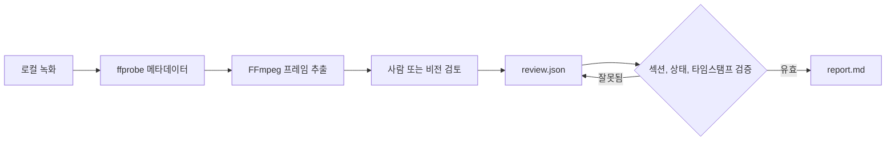

<div align="center">

# rea-game

게임 영상의 역공학을 돕고, 플레이 가능한 프로토타입 제작으로 이어 줍니다.

**게임플레이 영상을 타임스탬프가 있는 근거, 명확한 메커니즘 분석, 플레이 가능한 재현 버전을 위한 실용적인 계획으로 바꿔 보세요.**

rea-game은 Python CLI와 검토 워크플로를 결합합니다. FFmpeg로 프레임을 추출하고, 사람이나 비전 기능을 갖춘 어시스턴트가 영상을 검토한 뒤 CLI가 내용을 검증하고 Markdown 보고서를 생성합니다.

[MIT 라이선스](../LICENSE)로 제공되는 무료 오픈 소스 소프트웨어입니다.


[게임 사례](#게임-사례) · [사용 이유](#사용-이유) · [빠른 시작](#빠른-시작) · [예제](#예제-실행) · [검토 형식](#검토-형식) · [작동 방식](#작동-방식) · [자주 묻는 질문](#자주-묻는-질문)


</div>

[中文](README_zh.md) | [English](../README.md) | [Русский](README_ru.md) | [日本語](README_ja.md) | [한국어](README_ko.md) | [Español](README_es.md) | [Português](README_pt.md) | [Français](README_fr.md) | [Deutsch](README_de.md)

> 분석을 마친 뒤 플레이 가능한 재현 버전 제작을 이어 가세요. 코딩할 수 있다면 Claude Code나 Codex를 사용하거나 [Unity](https://unity.com/), [Unreal Engine](https://www.unrealengine.com/), [Godot](https://godotengine.org/) 개발 흐름을 선택하세요. 코딩을 하지 않는다면 [Seele AI](https://www.seeles.ai)로 다음 개발 단계에 진입할 수 있습니다.

## 게임 사례

각 사례에는 원본 영상, 12프레임 축소 커버(6열 × 2행), 타임스탬프가 표시된 근거 프레임, 작성이 끝난 검토 파일, 상세 타임라인과 게임플레이 가설을 담은 보고서가 포함됩니다. 관찰, 추론, 미해결 메커니즘은 서로 구분됩니다.

### Phantom Blade Zero


[Phantom Blade Zero 영상](../assets/cases/Phantom%20Blade%20Zero.mp4) · [분석 보고서](../assets/cases/analysis/phantom-blade-zero/report.md) · [근거 데이터](../assets/cases/analysis/phantom-blade-zero/evidence.json) · [검토 파일](../assets/cases/analysis/phantom-blade-zero/review.json) · [추출 프레임](../assets/cases/analysis/phantom-blade-zero/frames/)

<video controls preload="none" width="720"><source src="../assets/cases/Phantom%20Blade%20Zero.mp4" type="video/mp4">브라우저에서 이 영상을 재생할 수 없습니다. [영상 파일 열기](../assets/cases/Phantom%20Blade%20Zero.mp4).</video>

### Three Kingdoms Tactics


[Three Kingdoms Tactics 영상](../assets/cases/Three%20Kingdoms%20Tactics.mp4) · [분석 보고서](../assets/cases/analysis/three-kingdoms-tactics/report.md) · [근거 데이터](../assets/cases/analysis/three-kingdoms-tactics/evidence.json) · [검토 파일](../assets/cases/analysis/three-kingdoms-tactics/review.json) · [추출 프레임](../assets/cases/analysis/three-kingdoms-tactics/frames/)

<video controls preload="none" width="720"><source src="../assets/cases/Three%20Kingdoms%20Tactics.mp4" type="video/mp4">브라우저에서 이 영상을 재생할 수 없습니다. [영상 파일 열기](../assets/cases/Three%20Kingdoms%20Tactics.mp4).</video>

### Identity V


[Identity V 영상](../assets/cases/Identity%20V.mp4) · [분석 보고서](../assets/cases/analysis/identity-v/report.md) · [근거 데이터](../assets/cases/analysis/identity-v/evidence.json) · [검토 파일](../assets/cases/analysis/identity-v/review.json) · [추출 프레임](../assets/cases/analysis/identity-v/frames/)

<video controls preload="none" width="720"><source src="../assets/cases/Identity%20V.mp4" type="video/mp4">브라우저에서 이 영상을 재생할 수 없습니다. [영상 파일 열기](../assets/cases/Identity%20V.mp4).</video>

## 사용 이유

게임플레이 영상을 분석하다 보면 화면에서 보이는 것, 그 의미에 대한 판단, 추가로 확인할 사항을 혼동하기 쉽습니다. rea-game은 이를 분리합니다. 독자가 근거를 다시 확인할 수 있도록 관찰과 추론에는 타임스탬프를 포함해야 합니다.

프로토타입 제작 전에 참고 게임을 조사하거나, 플레이테스트 메모를 정리하거나, 비전 기능이 있는 어시스턴트에 일관된 검토 절차를 제공하는 데 사용할 수 있습니다.

## 빠른 시작

### 1. 도구 설치

Python 3.10 이상, FFmpeg, ffprobe가 필요합니다. 저장소 페이지에서 **Code → Download ZIP**을 선택하거나 **Code** 메뉴에 표시된 URL로 저장소를 복제하세요. 다운로드하거나 복제한 저장소의 루트(<code>pyproject.toml</code>이 있는 디렉터리)에서 터미널을 열고 아래 절차로 소스에서 설치합니다. 아직 PyPI에 공개되지 않아 <code>pip install rea-game</code>으로 설치할 수 없습니다.

#### macOS (Terminal)

먼저 [Homebrew](https://brew.sh/)를 설치한 다음 Python과 FFmpeg를 설치합니다.

```sh
brew install python@3.14 ffmpeg
python3.14 --version
ffmpeg -version
ffprobe -version
```

가상 환경을 만들고 활성화한 다음 저장소 루트에서 rea-game을 설치합니다.

```sh
python3.14 -m venv .venv
source .venv/bin/activate
python -m pip install .
rea-game --help
rea-game skill
```

새 터미널을 열 때마다 저장소 루트로 돌아와 <code>source .venv/bin/activate</code>를 다시 실행하세요.

#### Windows 10/11 (PowerShell)

[WinGet](https://learn.microsoft.com/windows/package-manager/winget/)으로 Python과 FFmpeg를 설치합니다.

```powershell
winget install --id Python.Python.3.14 --exact
winget install --id Gyan.FFmpeg --exact
```

PowerShell을 닫았다가 다시 열어 PATH 변경 사항을 적용합니다. 저장소 루트로 이동해 다음을 실행합니다.

```powershell
$env:PYTHONUTF8 = "1"
py -3.14 --version
ffmpeg -version
ffprobe -version
py -3.14 -m venv .venv
.\.venv\Scripts\python.exe -m pip install .
.\.venv\Scripts\rea-game.exe --help
.\.venv\Scripts\rea-game.exe skill
```

Windows 예제는 가상 환경의 실행 파일을 직접 호출하므로 스크립트를 활성화하거나 PowerShell 실행 정책을 변경할 필요가 없습니다. 이전 Python 버전에서도 UTF-8을 일관되게 사용하려면 새 PowerShell 세션마다 <code>$env:PYTHONUTF8 = "1"</code>을 설정하세요.

WinGet을 사용할 수 없다면 [python.org](https://www.python.org/downloads/windows/)에서 Python 3.14를 설치하세요. Python 설치 관리자를 사용한다면 먼저 <code>py install 3.14</code>를 실행합니다. [FFmpeg 다운로드 페이지](https://ffmpeg.org/download.html)에서 Windows 빌드를 받고, <code>ffmpeg.exe</code>와 <code>ffprobe.exe</code>가 모두 들어 있는 <code>bin</code> 디렉터리를 사용자 PATH에 추가하세요. PowerShell을 다시 열어 버전을 확인하고 두 명령을 터미널에서 사용할 수 있는지 확인합니다.

#### Linux (Ubuntu/Debian)

<code>apt</code>로 Python, 가상 환경 지원, FFmpeg를 설치합니다.

```sh
sudo apt update
sudo apt install python3 python3-venv ffmpeg
python3 --version
ffmpeg -version
ffprobe -version
```

<code>python3 --version</code>이 Python 3.10 이상을 표시하는지 확인하세요. 그런 다음 가상 환경을 만들고 활성화한 뒤 저장소 루트에서 rea-game을 설치합니다.

```sh
python3 -m venv .venv
source .venv/bin/activate
python -m pip install .
rea-game --help
rea-game skill
```

### 2. 프레임을 추출하고 영상 검토

macOS / Linux(가상 환경 활성화 상태):

```sh
rea-game extract "/path/to/gameplay.mp4" -o out/my-game --interval 3
```

Windows PowerShell:

```powershell
.\.venv\Scripts\rea-game.exe extract "C:\Videos\gameplay.mp4" -o out/my-game --interval 3
```

영상 경로를 실제 파일 경로로 바꾸세요. 경로에 공백이 있으면 따옴표를 유지합니다. <code>--interval</code>은 프레임 사이의 초 단위 간격이며 기본값은 5입니다. 0보다 큰 유한한 숫자여야 합니다. 프레임 수 오버플로를 일으키는 간격은 거부됩니다.

여러 비디오 트랙이 있는 파일에서는 커버 이미지가 아닌 첫 번째 트랙을 사용합니다. 프레임 크기, 트랙에서 확인 가능한 영상 길이, 추출 이미지는 모두 해당 트랙을 기준으로 합니다.

명령은 새 디렉터리를 만듭니다.

```text
out/my-game/
├── evidence.json   # 소스, 길이, 크기, 오디오 유무, 프레임 타임스탬프
├── frames/         # 추출된 JPEG 프레임
└── review.json     # 작성할 검토 템플릿
```

프레임을 확인한 뒤 중요한 장면 주변의 원본 영상을 재생해 프레임 사이에 무슨 일이 있었는지 확인하세요. 소리에 관해 판단하기 전에 오디오를 들어 보세요. 타임스탬프는 요청한 탐색 위치이며 디코딩된 프레임은 조금 다를 수 있습니다.

### 3. 보고서 생성

텍스트 편집기에서 <code>out/my-game/review.json</code>을 열고 [검토 형식](#검토-형식)에 따라 발견 내용을 추가한 뒤 UTF-8로 저장합니다. 기본 작성 언어는 영어입니다. 그런 다음 다음 명령을 실행하세요.

macOS / Linux:

```sh
rea-game report out/my-game
```

Windows PowerShell:

```powershell
.\.venv\Scripts\rea-game.exe report out/my-game
```

보고서는 <code>out/my-game/report.md</code>에 저장됩니다. 게임 루프, 조작, 규칙, 진행, 인터페이스, 아트, 사운드, 프로토타입 계획, 미해결 질문을 다루고 플레이 가능한 재현 버전을 향한 다음 단계도 제안합니다. 비어 있는 섹션에는 “Not yet reviewed.”가 표시됩니다.

## 예제 실행

저장소에는 3초짜리 합성 영상을 만드는 스크립트가 있습니다. 검은 배경의 흰색 사각형이 1초 지점에서 위치를 바꿉니다. 게임 에셋을 다운로드하지 않고 프레임 추출 및 보고서 생성 절차를 확인할 수 있지만 완전한 게임플레이 예제는 아닙니다.

| 0초 | 1초 |
| --- | --- |
|  |  |

저장소 루트에서 실행합니다. macOS / Linux에서는 먼저 가상 환경을 활성화하세요.

```sh
python examples/synthetic/create_video.py out/synthetic.mp4
rea-game extract out/synthetic.mp4 -o out/synthetic --interval 1
cp examples/synthetic/review.json out/synthetic/review.json
rea-game report out/synthetic
```

Windows PowerShell:

```powershell
$env:PYTHONUTF8 = "1"
.\.venv\Scripts\python.exe examples/synthetic/create_video.py out/synthetic.mp4
.\.venv\Scripts\rea-game.exe extract out/synthetic.mp4 -o out/synthetic --interval 1
Copy-Item examples/synthetic/review.json out/synthetic/review.json
.\.venv\Scripts\rea-game.exe report out/synthetic
```

예제 검토 파일을 복사하기 전에 프레임을 확인하고 영상을 재생해 사각형이 움직이는지 확인하세요. 다시 실행할 때는 새 영상 경로와 출력 디렉터리를 사용합니다.

[예제 보고서](../examples/synthetic/report.md), [검토 파일](../examples/synthetic/review.json), [단계별 안내](../examples/synthetic/README.md)를 참고하세요. 예제 보고서는 소스 경로로 <code>out/synthetic.mp4</code>를 사용하며, 생성한 보고서에는 실제 로컬 경로가 기록됩니다.

## 검토 형식

각 섹션은 항목 배열로 구성됩니다. 각 항목에는 <code>text</code>와 <code>status</code>가 필요합니다. <code>times</code>는 선택 사항이지만 관찰과 추론에는 녹화 범위 안의 타임스탬프가 하나 이상 있어야 합니다.

```json
{
  "core_loop": [
    {
      "text": "The counter increases when the character touches an item.",
      "status": "observation",
      "times": [12.3]
    }
  ],
  "unknowns": [
    {
      "text": "Do collected items respawn after a delay?",
      "status": "unverified",
      "times": []
    }
  ],
  "remake": [
    {
      "text": "Start with movement, item collection, and an on-screen counter.",
      "status": "proposal",
      "times": []
    }
  ]
}
```

이는 형식 예시일 뿐 사용자의 영상에 대한 분석 결과가 아닙니다. 생성된 템플릿의 섹션 키를 그대로 사용하세요. 오타를 확인하기 위해 알 수 없는 섹션과 항목 필드는 거부됩니다.

| 상태 | 용도 | 타임스탬프 |
| --- | --- | --- |
| <code>observation</code> | 녹화에서 직접 보이거나 들리는 내용 | 필수 |
| <code>inference</code> | 근거는 있지만 확인되지 않은 해석 | 필수 |
| <code>unverified</code> | 영상으로 확인할 수 없는 질문이나 주장 | 선택 |
| <code>proposal</code> | 프로토타입 제작을 위한 제안 | 선택 |

프로토타입 계획에는 최소 플레이 가능 버전, 핵심 메커니즘, 필요한 장면과 에셋, 구현 순서를 적어야 합니다. 영상만으로는 입력 매핑, 숨겨진 값, 모든 승패 조건, 원래 기술 스택을 알아내기 어려운 경우가 많습니다. 이런 불확실성은 명확하게 남겨 두세요.

## 작동 방식



CLI는 인수, JSON, 파일, 하위 프로세스를 처리할 때 Python 표준 라이브러리를 사용합니다. FFmpeg가 비디오를 디코딩합니다. 검토 데이터는 읽기 쉬운 JSON이고 보고서는 일반 Markdown입니다. 설치된 도구를 실행하는 데 모델, API 키, 네트워크 연결은 필요하지 않습니다. 클라우드 어시스턴트를 사용한다면 영상 업로드 여부는 해당 어시스턴트의 워크플로에 달려 있습니다.

보고서를 생성하기 전에 rea-game은 다음을 확인합니다.

- <code>evidence.json</code>에 비어 있지 않은 소스, 유한한 양수 길이, 유효한 프레임 인덱스가 있는지.
- <code>review.json</code>의 섹션 이름과 항목 필드가 알려진 형식인지.
- 상태가 유효하고 텍스트가 비어 있지 않으며 타임스탬프가 녹화 범위 안의 유한한 값인지. 관찰과 추론에는 타임스탬프가 필요합니다.

기존 검토 내용을 보호하기 위해 추출에는 새 출력 디렉터리가 필요합니다. 추출에 실패하면 해당 실행에서 만든 디렉터리를 삭제하므로 다시 시도할 수 있습니다. 보고서를 생성하면 선택한 디렉터리의 <code>report.md</code>가 덮어써집니다.

## 테스트 및 패키지

테스트는 FFmpeg에서 보고서까지의 전체 워크플로, 비디오 트랙 간 일관성, 매우 짧은 간격, 잘못된 JSON, 필드 검증, 타임스탬프 범위, 추출 실패 후 정리를 확인합니다. CI는 Linux, macOS, Windows에서 Python 3.10과 3.14를 대상으로 합니다. 테스트를 실행하고 wheel 및 소스 배포 패키지를 만들며 격리 환경에 각 패키지를 설치해 예제를 실행합니다. 패키지를 게시하지는 않습니다. 실제 결과는 저장소의 Actions 실행 기록에서 확인하세요.

개발 및 릴리스 검사는 [기여 안내](../CONTRIBUTING.md)를 참고하세요.

## 자주 묻는 질문

<details>
<summary>rea-game은 무료인가요?</summary>

네. rea-game은 MIT 라이선스로 배포되는 오픈 소스 소프트웨어입니다. CLI에는 구독, API 키, 사용료가 없습니다. 선택한 유료 AI 어시스턴트나 개발 서비스 비용은 별도입니다.

</details>

<details>
<summary>rea-game은 무엇을 하나요?</summary>

rea-game은 게임 영상을 구조화된 근거 기반 분석 보고서로 바꾸어 프로토타입 개발을 돕습니다. 타임스탬프가 있는 프레임을 추출하고 게임플레이, 조작, 규칙, 진행, UI, 아트, 오디오를 검토하는 절차를 제공하며, 검토 내용을 검증한 뒤 프로토타입 계획과 미해결 질문을 담은 Markdown 보고서를 만듭니다.

</details>

<details>
<summary>영상도 자동으로 분석하나요?</summary>

아니요. CLI는 프레임을 추출하고 사용자의 검토 내용으로 보고서를 생성할 뿐 게임플레이를 스스로 이해하지 못합니다. 사람이나 비전 기능이 있는 어시스턴트가 프레임과 관련 영상 구간을 확인하고 분석을 추가해야 합니다. 영상으로 확인할 수 없는 내용은 확정된 규칙처럼 다루지 말고 미검증으로 표시하세요.

</details>

<details>
<summary>분석 보고서는 어떤 용도로 쓰이나요?</summary>

영상에 보이는 게임 루프, 상호작용, 피드백, 미해결 메커니즘을 이해하고 공유하는 데 사용하세요. 프로토타입 계획은 발견 내용을 초기 범위, 핵심 메커니즘, 추천 장면과 에셋, 기술 선택지, 구현 순서로 정리합니다. 플레이 가능한 재현 버전을 계획하기 위한 실용적인 인계 자료이며 완전한 게임 명세서는 아닙니다.

</details>

<details>
<summary>보고서를 바탕으로 플레이 가능한 게임을 만들 수 있나요?</summary>

보고서는 근거가 있는 출발점이며 완성된 게임 코드나 에셋을 제공하지는 않습니다. 코딩할 수 있다면 Claude Code나 Codex를 이어서 사용하거나 [Unity](https://unity.com/), [Unreal Engine](https://www.unrealengine.com/), [Godot](https://godotengine.org/)로 개발할 수 있습니다. 코딩하지 않는다면 [Seele AI](https://www.seeles.ai)를 사용할 수 있습니다.

</details>

<details>
<summary>rea-game을 사용하려면 프로그래밍이 필요한가요?</summary>

게임 개발 기술은 필요하지 않지만 rea-game은 원클릭 웹 서비스가 아니라 로컬 명령줄 워크플로입니다. Python과 FFmpeg를 설치하고 몇 가지 명령을 실행한 뒤 <code>review.json</code>에 분석 내용을 추가해야 합니다. 직접 영상을 확인하거나 비전 기능이 있는 어시스턴트에게 검토를 부탁할 수 있습니다. 보고서를 바탕으로 자신에게 맞는 개발 경로를 고르면 됩니다.

</details>

<details>
<summary>어떤 영상을 분석하면 좋나요?</summary>

플레이어 행동과 그에 따른 화면 피드백이 보이는 게임플레이 녹화를 사용하세요. 짧은 영상은 특정 상호작용을 설명하기 좋고, 전체 게임 루프가 담긴 긴 영상은 더 많은 맥락을 제공합니다. 조작, 결과, 전환이 영상에 없다면 미해결 질문으로 기록하세요.

</details>

<details>
<summary>영상이 내 컴퓨터 밖으로 전송되나요?</summary>

CLI는 로컬 영상 파일을 처리하며 모델, API 키, 네트워크 연결이 필요하지 않습니다. 클라우드 어시스턴트에게 영상을 확인해 달라고 하면 업로드 여부는 해당 어시스턴트의 워크플로와 설정에 따라 달라집니다.

</details>

<details>
<summary>추출할 때 왜 새 디렉터리가 필요한가요?</summary>

기존 검토 작업을 보호하기 위해서입니다. 성공적으로 만든 출력 디렉터리는 사용자가 관리하고, 추출 실패 시에는 해당 실행이 만든 디렉터리만 삭제됩니다.

</details>

<details>
<summary>검토 내용을 다른 언어로 작성해도 되나요?</summary>

네. CLI, 보고서 제목, 예제, 어시스턴트 워크플로의 기본 언어는 영어입니다. 보고서는 입력한 텍스트를 보존하며 번역하지 않습니다. 상태 값은 항상 <code>observation</code>, <code>inference</code>, <code>unverified</code>, <code>proposal</code>을 사용해야 합니다.

</details>

<details>
<summary>보고서를 공유하기 전에 무엇을 확인해야 하나요?</summary>

보고서와 <code>evidence.json</code>에는 영상의 로컬 경로가 포함됩니다. 공유 전 경로에 개인 정보가 있는지 확인하고 영상, 스크린샷, 음악, 게임 에셋을 사용할 권리가 있는지 확인하세요. 저장소의 MIT 라이선스는 타사 게임 콘텐츠에 대한 권리를 부여하지 않습니다.

</details>

## 기여하기

버그 보고, 제안, 풀 리퀘스트를 환영합니다. 환경 설정, 이슈 보고, 릴리스 검사는 [기여 안내](../CONTRIBUTING.md)를 참고하세요.

macOS / Linux(가상 환경 활성화 상태):

```sh
python -m unittest discover -s tests
```

Windows PowerShell:

```powershell
$env:PYTHONUTF8 = "1"
.\.venv\Scripts\python.exe -m unittest discover -s tests
```

## 감사의 말과 라이선스

REA(Reverse Engineer Anything)에서 영감을 받았습니다. 눈에 보이는 것에서 구현 방법을 추적하고, 모든 주장을 근거로 뒷받침하고, 측정으로 검증한다는 접근입니다.

코드와 오리지널 합성 예제는 [MIT 라이선스](../LICENSE)로 제공됩니다. 자세한 내용은 [검토 워크플로](../rea_game/SKILL.md)와 [변경 기록](../CHANGELOG.md)을 참고하세요.
