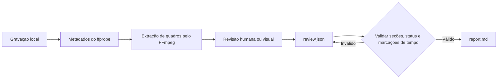

<div align="center">

# rea-game

Faça engenharia reversa de qualquer vídeo de jogo, da gravação a um protótipo jogável.

**Transforme vídeos de jogos em evidências com marcações de tempo, uma análise clara das mecânicas e um plano prático para criar uma recriação jogável.**

rea-game combina uma CLI em Python com um fluxo de revisão. O FFmpeg extrai quadros, uma pessoa ou um assistente com capacidade visual analisa a gravação, e a CLI valida a revisão e gera um relatório Markdown.

Software gratuito e de código aberto sob a [licença MIT](../LICENSE).


[Casos de jogos](#casos-de-jogos) · [Por que usar](#por-que-usar) · [Início rápido](#início-rápido) · [Exemplo](#teste-o-exemplo) · [Formato da revisão](#formato-da-revisão) · [Como funciona](#como-funciona) · [Perguntas frequentes](#perguntas-frequentes)


</div>

[中文](README_zh.md) | [English](../README.md) | [Русский](README_ru.md) | [日本語](README_ja.md) | [한국어](README_ko.md) | [Español](README_es.md) | [Português](README_pt.md) | [Français](README_fr.md) | [Deutsch](README_de.md)

> Depois da análise, continue até criar uma recriação jogável. Se você programa, use Claude Code ou Codex, ou escolha um fluxo de desenvolvimento com [Unity](https://unity.com/), [Unreal Engine](https://www.unrealengine.com/) ou [Godot](https://godotengine.org/). Se não programa, use [Seele AI](https://www.seeles.ai) para seguir com o desenvolvimento.

## Casos de jogos

Cada caso inclui o vídeo original, uma capa compactada de 12 quadros (6 colunas × 2 linhas), quadros de evidência com marcações de tempo, a revisão preenchida e um relatório com linha do tempo detalhada e hipóteses de jogo. Observações são separadas de inferências e de mecânicas ainda não esclarecidas.

### Phantom Blade Zero


[Assistir a Phantom Blade Zero](../assets/cases/Phantom%20Blade%20Zero.mp4) · [Ler o relatório de análise](../assets/cases/analysis/phantom-blade-zero/report.md) · [Evidências](../assets/cases/analysis/phantom-blade-zero/evidence.json) · [Revisão](../assets/cases/analysis/phantom-blade-zero/review.json) · [Quadros extraídos](../assets/cases/analysis/phantom-blade-zero/frames/)

<video controls preload="none" width="720"><source src="../assets/cases/Phantom%20Blade%20Zero.mp4" type="video/mp4">Seu navegador não consegue reproduzir este vídeo. [Abrir o arquivo de vídeo](../assets/cases/Phantom%20Blade%20Zero.mp4).</video>

### Three Kingdoms Tactics


[Assistir a Three Kingdoms Tactics](../assets/cases/Three%20Kingdoms%20Tactics.mp4) · [Ler o relatório de análise](../assets/cases/analysis/three-kingdoms-tactics/report.md) · [Evidências](../assets/cases/analysis/three-kingdoms-tactics/evidence.json) · [Revisão](../assets/cases/analysis/three-kingdoms-tactics/review.json) · [Quadros extraídos](../assets/cases/analysis/three-kingdoms-tactics/frames/)

<video controls preload="none" width="720"><source src="../assets/cases/Three%20Kingdoms%20Tactics.mp4" type="video/mp4">Seu navegador não consegue reproduzir este vídeo. [Abrir o arquivo de vídeo](../assets/cases/Three%20Kingdoms%20Tactics.mp4).</video>

### Identity V


[Assistir a Identity V](../assets/cases/Identity%20V.mp4) · [Ler o relatório de análise](../assets/cases/analysis/identity-v/report.md) · [Evidências](../assets/cases/analysis/identity-v/evidence.json) · [Revisão](../assets/cases/analysis/identity-v/review.json) · [Quadros extraídos](../assets/cases/analysis/identity-v/frames/)

<video controls preload="none" width="720"><source src="../assets/cases/Identity%20V.mp4" type="video/mp4">Seu navegador não consegue reproduzir este vídeo. [Abrir o arquivo de vídeo](../assets/cases/Identity%20V.mp4).</video>

## Por que usar

Ao analisar vídeos de jogos, é fácil confundir o que você vê, o que acredita que isso significa e o que ainda precisa verificar. rea-game mantém essas coisas separadas. Observações e inferências devem citar marcações de tempo para que os leitores possam conferir as evidências.

Use a ferramenta para estudar um jogo de referência antes de criar um protótipo, organizar anotações de testes ou oferecer um processo de revisão consistente a um assistente com capacidade visual.

## Início rápido

### 1. Instale as ferramentas

Você precisa do Python 3.10 ou posterior, FFmpeg e ffprobe. Na página do repositório, escolha **Code → Download ZIP** ou clone-o usando a URL exibida em **Code**. Abra um terminal na raiz do repositório baixado ou clonado, onde está o <code>pyproject.toml</code>, e instale a partir do código-fonte seguindo os passos abaixo. O projeto ainda não está disponível no PyPI, portanto <code>pip install rea-game</code> não funciona.

#### macOS (Terminal)

Instale primeiro o [Homebrew](https://brew.sh/) e depois Python e FFmpeg:

```sh
brew install python@3.14 ffmpeg
python3.14 --version
ffmpeg -version
ffprobe -version
```

Crie e ative um ambiente virtual e instale rea-game a partir da raiz do repositório:

```sh
python3.14 -m venv .venv
source .venv/bin/activate
python -m pip install .
rea-game --help
rea-game skill
```

Sempre que abrir um novo terminal, volte à raiz do repositório e execute novamente <code>source .venv/bin/activate</code>.

#### Windows 10/11 (PowerShell)

Instale Python e FFmpeg usando o [WinGet](https://learn.microsoft.com/windows/package-manager/winget/):

```powershell
winget install --id Python.Python.3.14 --exact
winget install --id Gyan.FFmpeg --exact
```

Feche e reabra o PowerShell para aplicar as alterações do PATH. Volte à raiz do repositório e execute:

```powershell
$env:PYTHONUTF8 = "1"
py -3.14 --version
ffmpeg -version
ffprobe -version
py -3.14 -m venv .venv
.\.venv\Scripts\python.exe -m pip install .
.\.venv\Scripts\rea-game.exe --help
.\.venv\Scripts\rea-game.exe skill
```

Os exemplos do Windows chamam diretamente os executáveis do ambiente virtual, então não é necessário ativar um script nem alterar a política de execução do PowerShell. Defina <code>$env:PYTHONUTF8 = "1"</code> em cada nova sessão do PowerShell para manter o uso de UTF-8 em versões antigas do Python.

Se não tiver WinGet, instale o Python 3.14 em [python.org](https://www.python.org/downloads/windows/). Se usar o gerenciador de instalação do Python, execute primeiro <code>py install 3.14</code>. Baixe uma compilação para Windows na [página de download do FFmpeg](https://ffmpeg.org/download.html) e adicione ao PATH do usuário o diretório <code>bin</code>, que contém <code>ffmpeg.exe</code> e <code>ffprobe.exe</code>. Abra o PowerShell novamente e confira as versões; ambos os comandos precisam estar disponíveis no terminal.

#### Linux (Ubuntu/Debian)

Use <code>apt</code> para instalar Python, o suporte a ambientes virtuais e FFmpeg:

```sh
sudo apt update
sudo apt install python3 python3-venv ffmpeg
python3 --version
ffmpeg -version
ffprobe -version
```

Confirme que <code>python3 --version</code> indica Python 3.10 ou posterior. Depois crie e ative um ambiente virtual e instale rea-game na raiz do repositório:

```sh
python3 -m venv .venv
source .venv/bin/activate
python -m pip install .
rea-game --help
rea-game skill
```

### 2. Extraia quadros e revise o vídeo

macOS / Linux, com o ambiente virtual ativo:

```sh
rea-game extract "/path/to/gameplay.mp4" -o out/my-game --interval 3
```

Windows PowerShell:

```powershell
.\.venv\Scripts\rea-game.exe extract "C:\Videos\gameplay.mp4" -o out/my-game --interval 3
```

Substitua o caminho pelo do seu vídeo. Mantenha as aspas quando o caminho tiver espaços. <code>--interval</code> define os segundos entre quadros e o padrão é 5. O valor precisa ser um número finito maior que zero. Intervalos que causariam estouro na contagem de quadros são rejeitados.

Se o arquivo tiver várias trilhas de vídeo, rea-game usa a primeira que não for uma imagem de capa. As dimensões dos quadros, a duração quando disponível na trilha e as imagens extraídas vêm dessa trilha.

O comando cria um diretório novo:

```text
out/my-game/
├── evidence.json   # Origem, duração, dimensões, presença de áudio e tempos dos quadros
├── frames/         # Quadros JPEG extraídos
└── review.json     # Modelo de revisão para preencher
```

Confira os quadros e depois assista ao vídeo original perto dos momentos importantes para verificar o que acontece entre eles. Ouça o áudio antes de fazer afirmações sobre som. As marcações indicam posições de busca solicitadas; os quadros decodificados podem variar um pouco.

### 3. Gere um relatório

Abra <code>out/my-game/review.json</code> em um editor de texto, registre suas descobertas conforme o [formato da revisão](#formato-da-revisão) e salve como UTF-8. O idioma padrão de escrita é inglês. Depois execute:

macOS / Linux:

```sh
rea-game report out/my-game
```

Windows PowerShell:

```powershell
.\.venv\Scripts\rea-game.exe report out/my-game
```

O relatório será salvo em <code>out/my-game/report.md</code>. Ele cobre ciclo de jogo, controles, regras, progressão, interface, arte, som, plano de protótipo e perguntas em aberto, além de sugerir próximos passos para chegar a uma recriação jogável. Seções vazias exibem “Not yet reviewed.”

## Teste o exemplo

O repositório inclui um gerador de vídeo sintético de três segundos: um quadrado branco sobre fundo preto muda de posição na marca de um segundo. Ele demonstra o processo de extração e geração de relatório sem baixar arquivos de jogos, mas não é um exemplo completo de jogo.

| 0 segundos | 1 segundo |
| --- | --- |
|  |  |

Execute na raiz do repositório. No macOS / Linux, ative primeiro o ambiente virtual:

```sh
python examples/synthetic/create_video.py out/synthetic.mp4
rea-game extract out/synthetic.mp4 -o out/synthetic --interval 1
cp examples/synthetic/review.json out/synthetic/review.json
rea-game report out/synthetic
```

Windows PowerShell:

```powershell
$env:PYTHONUTF8 = "1"
.\.venv\Scripts\python.exe examples/synthetic/create_video.py out/synthetic.mp4
.\.venv\Scripts\rea-game.exe extract out/synthetic.mp4 -o out/synthetic --interval 1
Copy-Item examples/synthetic/review.json out/synthetic/review.json
.\.venv\Scripts\rea-game.exe report out/synthetic
```

Antes de copiar a revisão de exemplo, confira os quadros e reproduza o vídeo para confirmar o movimento. Ao executar o exemplo novamente, use outro caminho de vídeo e diretório de saída.

Consulte o [relatório de exemplo](../examples/synthetic/report.md), o [arquivo de revisão](../examples/synthetic/review.json) e o [guia passo a passo](../examples/synthetic/README.md). O relatório de exemplo usa <code>out/synthetic.mp4</code> como caminho de origem; o seu relatório registrará o caminho local real.

## Formato da revisão

Cada seção contém uma matriz de entradas. Toda entrada precisa de <code>text</code> e <code>status</code>. <code>times</code> é opcional, exceto para observações e inferências, que devem citar pelo menos uma marca de tempo dentro da gravação:

```json
{
  "core_loop": [
    {
      "text": "The counter increases when the character touches an item.",
      "status": "observation",
      "times": [12.3]
    }
  ],
  "unknowns": [
    {
      "text": "Do collected items respawn after a delay?",
      "status": "unverified",
      "times": []
    }
  ],
  "remake": [
    {
      "text": "Start with movement, item collection, and an on-screen counter.",
      "status": "proposal",
      "times": []
    }
  ]
}
```

São exemplos do formato, não conclusões sobre o seu vídeo. Mantenha as chaves de seção do modelo gerado. Seções e campos desconhecidos são rejeitados para detectar erros de digitação.

| Status | Uso | Marcações de tempo |
| --- | --- | --- |
| <code>observation</code> | Algo diretamente visível ou audível na gravação | Obrigatória |
| <code>inference</code> | Interpretação apoiada por evidências, mas ainda não confirmada | Obrigatória |
| <code>unverified</code> | Pergunta ou afirmação que o vídeo não permite resolver | Opcional |
| <code>proposal</code> | Abordagem sugerida para criar um protótipo | Opcional |

O plano do protótipo deve indicar a menor versão jogável, as mecânicas centrais, as cenas e os recursos necessários e a ordem de implementação. Só o vídeo geralmente não permite determinar mapeamentos de entrada, valores ocultos, todas as condições de vitória ou derrota nem a tecnologia original. Deixe essas incertezas explícitas.

## Como funciona



A CLI usa a biblioteca padrão do Python para argumentos, JSON, arquivos e subprocessos. O FFmpeg decodifica o vídeo. Os dados de revisão são JSON legível e os relatórios são Markdown simples. A ferramenta instalada não precisa de modelo, chave de API ou conexão de rede. Se você usar um assistente em nuvem, o fluxo dele determina se o vídeo será enviado.

Antes de gerar um relatório, rea-game verifica:

- Se <code>evidence.json</code> contém uma origem não vazia, duração finita e positiva e índice de quadro válido.
- Se <code>review.json</code> usa nomes de seção e campos de entrada reconhecidos.
- Se os status são válidos, o texto não está vazio e as marcações de tempo são finitas e estão dentro da gravação. Observações e inferências precisam de marcações.

Para proteger revisões existentes, a extração exige um diretório de saída novo. Se falhar, o diretório criado por aquela execução é removido para permitir uma nova tentativa. Gerar um relatório sobrescreve <code>report.md</code> no diretório escolhido.

## Testes e pacotes

Os testes cobrem todo o fluxo do FFmpeg ao relatório, consistência entre várias trilhas, intervalos minúsculos, JSON inválido, validação de campos, limites de tempo e limpeza após falhas na extração. O CI usa Python 3.10 e 3.14 no Linux, macOS e Windows. Executa testes, cria um wheel e uma distribuição de código-fonte e instala cada pacote em um ambiente isolado para rodar o exemplo. Não publica pacotes. Consulte as execuções de Actions do repositório para ver os resultados reais.

Veja [CONTRIBUTING.md](../CONTRIBUTING.md) para as verificações de desenvolvimento e lançamento.

## Perguntas frequentes

<details>
<summary>rea-game é gratuito?</summary>

Sim. rea-game é software de código aberto sob a licença MIT. A CLI não tem assinatura, chave de API ou taxa de uso. Qualquer assistente de IA ou serviço de desenvolvimento pago que você escolher é independente.

</details>

<details>
<summary>O que rea-game faz?</summary>

rea-game transforma vídeos de jogos em relatórios de análise estruturados e baseados em evidências que podem apoiar o desenvolvimento de protótipos. Extrai quadros com marcações de tempo, oferece um fluxo de revisão de jogo, controles, regras, progressão, UI, arte e áudio, valida a revisão e cria um relatório Markdown com plano de protótipo e perguntas em aberto.

</details>

<details>
<summary>rea-game analisa o vídeo automaticamente?</summary>

Não. A CLI extrai quadros e gera um relatório a partir da sua revisão; ela não entende o jogo sozinha. Uma pessoa ou um assistente com capacidade visual deve examinar os quadros e trechos relevantes do vídeo e adicionar a análise. Marque como não verificados os detalhes que a gravação não permite confirmar, em vez de tratar uma suposição como regra comprovada.

</details>

<details>
<summary>Para que serve o relatório?</summary>

Use-o para entender e comunicar o ciclo de jogo visível, as interações, as respostas do jogo e as mecânicas não resolvidas. O plano de protótipo transforma as descobertas em escopo inicial, mecânicas centrais, cenas e recursos sugeridos, opções de tecnologia e ordem de implementação. É uma transferência prática para planejar uma recriação jogável, não uma especificação completa do jogo.

</details>

<details>
<summary>Posso criar um jogo jogável com base no relatório?</summary>

O relatório oferece um ponto de partida fundamentado, não código nem recursos de jogo prontos. Se você programa, continue com Claude Code ou Codex, ou desenvolva com [Unity](https://unity.com/), [Unreal Engine](https://www.unrealengine.com/) ou [Godot](https://godotengine.org/). Se não programa, use [Seele AI](https://www.seeles.ai) para seguir.

</details>

<details>
<summary>Preciso saber programar para usar rea-game?</summary>

Você não precisa ter experiência em desenvolvimento de jogos, mas rea-game é um fluxo local de linha de comando, não um serviço web de um clique. Será preciso instalar Python e FFmpeg, executar alguns comandos e acrescentar descobertas a <code>review.json</code>. Você pode analisar o vídeo ou pedir ajuda a um assistente com capacidade visual. O relatório ajuda a escolher um caminho de desenvolvimento adequado às suas habilidades.

</details>

<details>
<summary>Que tipo de vídeo devo analisar?</summary>

Use uma gravação que mostre as ações do jogador e a resposta correspondente na tela. Um clipe curto pode explicar uma interação específica; uma gravação longa com um ciclo de jogo completo oferece mais contexto. Se controles, resultados ou transições não aparecerem, registre-os como perguntas em aberto.

</details>

<details>
<summary>Meu vídeo sai do computador?</summary>

A CLI processa um arquivo local e não exige modelo, chave de API ou conexão de rede. Se você pedir a um assistente em nuvem que examine o vídeo, o envio dependerá do fluxo e das configurações desse assistente.

</details>

<details>
<summary>Por que a extração exige um diretório novo?</summary>

Para proteger o trabalho de revisão existente. Você gerencia os diretórios de saída concluídos; uma extração que falha remove apenas o diretório criado por aquela execução.

</details>

<details>
<summary>Posso escrever as entradas da revisão em outro idioma?</summary>

Sim. O idioma padrão da CLI, dos títulos do relatório, dos exemplos e do fluxo de trabalho do assistente é inglês. O relatório mantém o texto que você escreveu e não o traduz. Os status devem ser sempre <code>observation</code>, <code>inference</code>, <code>unverified</code> ou <code>proposal</code>.

</details>

<details>
<summary>O que devo verificar antes de compartilhar um relatório?</summary>

O relatório e <code>evidence.json</code> incluem o caminho local do vídeo. Antes de compartilhar, verifique se há caminhos privados e confirme que você tem permissão para usar o vídeo, as capturas, a música e os recursos do jogo. A licença MIT do repositório não concede direitos sobre conteúdo de terceiros.

</details>

## Contribua

Relatos de bugs, sugestões e pull requests são bem-vindos. Consulte o [guia de contribuição](../CONTRIBUTING.md) para configuração, comunicação de problemas e verificações de lançamento.

macOS / Linux, com o ambiente virtual ativo:

```sh
python -m unittest discover -s tests
```

Windows PowerShell:

```powershell
$env:PYTHONUTF8 = "1"
.\.venv\Scripts\python.exe -m unittest discover -s tests
```

## Créditos e licença

Inspirado em REA (Reverse Engineer Anything): rastrear o que você vê até como foi feito, sustentar cada afirmação com evidências e verificar por medição.

O código e o exemplo sintético original estão sob a [licença MIT](../LICENSE). Consulte o [fluxo de revisão](../rea_game/SKILL.md) e o [registro de alterações](../CHANGELOG.md) para mais detalhes.
