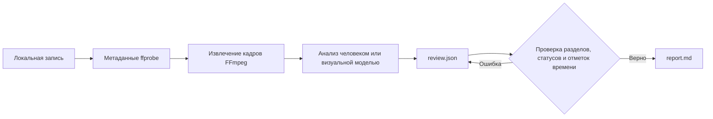

<div align="center">

# rea-game

Обратный анализ любого игрового видео — от записи игрового процесса до играбельного прототипа.

**Преобразуйте игровые видео в материалы с отметками времени, понятный разбор механик и практический план создания играбельной версии.**

rea-game объединяет интерфейс командной строки на Python с процессом анализа. FFmpeg извлекает кадры, человек или помощник с визуальными возможностями изучает запись, а CLI проверяет анализ и создает отчет в Markdown.

Бесплатное ПО с открытым исходным кодом по [лицензии MIT](../LICENSE).


[Примеры игр](#примеры-игр) · [Зачем использовать](#зачем-использовать) · [Быстрый старт](#быстрый-старт) · [Пример](#пример) · [Формат анализа](#формат-анализа) · [Как это работает](#как-это-работает) · [Вопросы и ответы](#вопросы-и-ответы)


</div>

[中文](README_zh.md) | [English](../README.md) | [Русский](README_ru.md) | [日本語](README_ja.md) | [한국어](README_ko.md) | [Español](README_es.md) | [Português](README_pt.md) | [Français](README_fr.md) | [Deutsch](README_de.md)

> После анализа можно перейти к созданию играбельной версии. Если вы умеете программировать, используйте Claude Code или Codex либо выберите процесс разработки с [Unity](https://unity.com/), [Unreal Engine](https://www.unrealengine.com/) или [Godot](https://godotengine.org/). Если вы не программируете, продолжить разработку поможет [Seele AI](https://www.seeles.ai).

## Примеры игр

Каждый пример содержит исходное видео, сжатую обложку из 12 кадров (6 столбцов × 2 строки), кадры-доказательства с отметками времени, заполненный файл анализа и отчет с подробной временной шкалой и гипотезами об игровом процессе. Наблюдения отделены от выводов и неразрешенных вопросов о механиках.

### Phantom Blade Zero


[Смотреть Phantom Blade Zero](../assets/cases/Phantom%20Blade%20Zero.mp4) · [Отчет об анализе](../assets/cases/analysis/phantom-blade-zero/report.md) · [Доказательства](../assets/cases/analysis/phantom-blade-zero/evidence.json) · [Анализ](../assets/cases/analysis/phantom-blade-zero/review.json) · [Извлеченные кадры](../assets/cases/analysis/phantom-blade-zero/frames/)

<video controls preload="none" width="720"><source src="../assets/cases/Phantom%20Blade%20Zero.mp4" type="video/mp4">Ваш браузер не может воспроизвести это видео. [Открыть видеофайл](../assets/cases/Phantom%20Blade%20Zero.mp4).</video>

### Three Kingdoms Tactics


[Смотреть Three Kingdoms Tactics](../assets/cases/Three%20Kingdoms%20Tactics.mp4) · [Отчет об анализе](../assets/cases/analysis/three-kingdoms-tactics/report.md) · [Доказательства](../assets/cases/analysis/three-kingdoms-tactics/evidence.json) · [Анализ](../assets/cases/analysis/three-kingdoms-tactics/review.json) · [Извлеченные кадры](../assets/cases/analysis/three-kingdoms-tactics/frames/)

<video controls preload="none" width="720"><source src="../assets/cases/Three%20Kingdoms%20Tactics.mp4" type="video/mp4">Ваш браузер не может воспроизвести это видео. [Открыть видеофайл](../assets/cases/Three%20Kingdoms%20Tactics.mp4).</video>

### Identity V


[Смотреть Identity V](../assets/cases/Identity%20V.mp4) · [Отчет об анализе](../assets/cases/analysis/identity-v/report.md) · [Доказательства](../assets/cases/analysis/identity-v/evidence.json) · [Анализ](../assets/cases/analysis/identity-v/review.json) · [Извлеченные кадры](../assets/cases/analysis/identity-v/frames/)

<video controls preload="none" width="720"><source src="../assets/cases/Identity%20V.mp4" type="video/mp4">Ваш браузер не может воспроизвести это видео. [Открыть видеофайл](../assets/cases/Identity%20V.mp4).</video>

## Зачем использовать

При анализе игрового видео легко смешать то, что вы видите, то, что, по вашему мнению, это означает, и то, что еще нужно проверить. rea-game разделяет эти вещи. Наблюдения и выводы должны содержать отметки времени, чтобы читатели могли вернуться к доказательствам.

Используйте инструмент, чтобы изучить игру-ориентир перед созданием прототипа, упорядочить заметки о тестировании или задать единый процесс анализа для помощника с визуальными возможностями.

## Быстрый старт

### 1. Установите инструменты

Понадобятся Python 3.10 или новее, FFmpeg и ffprobe. На странице репозитория выберите **Code → Download ZIP** либо клонируйте репозиторий по адресу из меню **Code**. Откройте терминал в корне скачанного или клонированного репозитория, где находится <code>pyproject.toml</code>, и установите rea-game из исходного кода по инструкциям ниже. Пакет пока недоступен в PyPI, поэтому команда <code>pip install rea-game</code> не подойдет.

#### macOS (Терминал)

Сначала установите [Homebrew](https://brew.sh/), затем Python и FFmpeg:

```sh
brew install python@3.14 ffmpeg
python3.14 --version
ffmpeg -version
ffprobe -version
```

Создайте виртуальное окружение, активируйте его и установите rea-game из корня репозитория:

```sh
python3.14 -m venv .venv
source .venv/bin/activate
python -m pip install .
rea-game --help
rea-game skill
```

При каждом новом запуске терминала вернитесь в корень репозитория и снова выполните <code>source .venv/bin/activate</code>.

#### Windows 10/11 (PowerShell)

Установите Python и FFmpeg с помощью [WinGet](https://learn.microsoft.com/windows/package-manager/winget/):

```powershell
winget install --id Python.Python.3.14 --exact
winget install --id Gyan.FFmpeg --exact
```

Закройте и снова откройте PowerShell, чтобы обновился PATH. Перейдите в корень репозитория и выполните:

```powershell
$env:PYTHONUTF8 = "1"
py -3.14 --version
ffmpeg -version
ffprobe -version
py -3.14 -m venv .venv
.\.venv\Scripts\python.exe -m pip install .
.\.venv\Scripts\rea-game.exe --help
.\.venv\Scripts\rea-game.exe skill
```

Команды для Windows напрямую запускают исполняемые файлы виртуального окружения: активировать скрипт или менять политику выполнения PowerShell не нужно. В каждом новом сеансе PowerShell задавайте <code>$env:PYTHONUTF8 = "1"</code>, чтобы старые версии Python также использовали UTF-8.

Если WinGet недоступен, установите Python 3.14 с сайта [python.org](https://www.python.org/downloads/windows/). При использовании диспетчера установки Python сначала выполните <code>py install 3.14</code>. Скачайте сборку Windows на [странице FFmpeg](https://ffmpeg.org/download.html) и добавьте в пользовательский PATH каталог <code>bin</code>, в котором находятся <code>ffmpeg.exe</code> и <code>ffprobe.exe</code>. Снова откройте PowerShell и проверьте версии: обе команды должны запускаться из терминала.

#### Linux (Ubuntu/Debian)

Установите Python, поддержку виртуальных окружений и FFmpeg с помощью <code>apt</code>:

```sh
sudo apt update
sudo apt install python3 python3-venv ffmpeg
python3 --version
ffmpeg -version
ffprobe -version
```

Убедитесь, что <code>python3 --version</code> показывает Python 3.10 или новее. Затем создайте и активируйте виртуальное окружение и установите rea-game из корня репозитория:

```sh
python3 -m venv .venv
source .venv/bin/activate
python -m pip install .
rea-game --help
rea-game skill
```

### 2. Извлеките кадры и изучите видео

macOS / Linux с активированным виртуальным окружением:

```sh
rea-game extract "/path/to/gameplay.mp4" -o out/my-game --interval 3
```

Windows PowerShell:

```powershell
.\.venv\Scripts\rea-game.exe extract "C:\Videos\gameplay.mp4" -o out/my-game --interval 3
```

Замените путь на путь к своему видео. Если в пути есть пробелы, не убирайте кавычки. Параметр <code>--interval</code> задает интервал между кадрами в секундах; значение по умолчанию — 5. Интервал должен быть конечным числом больше нуля. Значения, при которых количество кадров переполняется, отклоняются.

Если в файле несколько видеодорожек, rea-game использует первую дорожку, которая не является изображением обложки. Размеры кадров, длительность (если она доступна для дорожки) и извлеченные изображения берутся из нее.

Команда создает новый каталог:

```text
out/my-game/
├── evidence.json   # Источник, длительность, размеры, наличие аудио и отметки времени кадров
├── frames/         # Извлеченные кадры JPEG
└── review.json     # Шаблон для заполнения анализа
```

Просмотрите кадры, затем откройте соответствующие моменты исходного видео и проверьте, что происходит между кадрами. Перед выводами о звуке прослушайте аудио. Отметки времени указывают запрошенные позиции перемотки; декодированные кадры могут немного отличаться.

### 3. Создайте отчет

Откройте <code>out/my-game/review.json</code> в текстовом редакторе, внесите наблюдения по [формату анализа](#формат-анализа) и сохраните файл в UTF-8. По умолчанию пишите на английском. Затем выполните команду:

macOS / Linux:

```sh
rea-game report out/my-game
```

Windows PowerShell:

```powershell
.\.venv\Scripts\rea-game.exe report out/my-game
```

Отчет будет сохранен в <code>out/my-game/report.md</code>. В нем описаны игровой цикл, управление, правила, развитие, интерфейс, графика, звук, план прототипа и открытые вопросы, а затем предложены следующие шаги к играбельной версии. Для пустых разделов будет указано “Not yet reviewed.”

## Пример

В репозитории есть генератор трехсекундного синтетического ролика: белый квадрат на черном фоне меняет положение на отметке в одну секунду. Этот пример показывает процесс извлечения кадров и создания отчета без загрузки игровых материалов. Это не полноценный пример игрового процесса.

| 0 секунд | 1 секунда |
| --- | --- |
|  |  |

Запускайте команды из корня репозитория. На macOS / Linux сначала активируйте виртуальное окружение:

```sh
python examples/synthetic/create_video.py out/synthetic.mp4
rea-game extract out/synthetic.mp4 -o out/synthetic --interval 1
cp examples/synthetic/review.json out/synthetic/review.json
rea-game report out/synthetic
```

Windows PowerShell:

```powershell
$env:PYTHONUTF8 = "1"
.\.venv\Scripts\python.exe examples/synthetic/create_video.py out/synthetic.mp4
.\.venv\Scripts\rea-game.exe extract out/synthetic.mp4 -o out/synthetic --interval 1
Copy-Item examples/synthetic/review.json out/synthetic/review.json
.\.venv\Scripts\rea-game.exe report out/synthetic
```

Перед копированием файла анализа примера просмотрите кадры и включите ролик, чтобы убедиться в перемещении квадрата. При повторном запуске используйте новый путь для видео и новый каталог вывода.

См. [пример отчета](../examples/synthetic/report.md), [файл анализа](../examples/synthetic/review.json) и [пошаговое руководство](../examples/synthetic/README.md). В отчете примера в качестве источника указан <code>out/synthetic.mp4</code>; ваш отчет запишет фактический локальный путь.

## Формат анализа

Каждый раздел содержит массив записей. Для каждой записи обязательны поля <code>text</code> и <code>status</code>. Поле <code>times</code> необязательно, кроме наблюдений и выводов: для них нужна хотя бы одна отметка времени в пределах записи.

```json
{
  "core_loop": [
    {
      "text": "The counter increases when the character touches an item.",
      "status": "observation",
      "times": [12.3]
    }
  ],
  "unknowns": [
    {
      "text": "Do collected items respawn after a delay?",
      "status": "unverified",
      "times": []
    }
  ],
  "remake": [
    {
      "text": "Start with movement, item collection, and an on-screen counter.",
      "status": "proposal",
      "times": []
    }
  ]
}
```

Это примеры формата, а не выводы о вашем видео. Сохраняйте ключи разделов из созданного шаблона. Неизвестные разделы и поля записей отклоняются, чтобы выявлять опечатки.

| Статус | Для чего использовать | Отметки времени |
| --- | --- | --- |
| <code>observation</code> | То, что прямо видно или слышно в записи | Обязательны |
| <code>inference</code> | Подкрепленная доказательствами, но не подтвержденная интерпретация | Обязательны |
| <code>unverified</code> | Вопрос или утверждение, которое нельзя разрешить по видео | Необязательны |
| <code>proposal</code> | Предложение по реализации прототипа | Необязательны |

План прототипа должен описывать минимальную играбельную версию, основные механики, нужные сцены и материалы, а также порядок реализации. По одному видео обычно нельзя определить привязку ввода, скрытые значения, все условия победы и поражения или исходный технологический стек. Явно отмечайте такие неизвестные.

## Как это работает



CLI использует стандартную библиотеку Python для аргументов, JSON, файлов и подпроцессов. FFmpeg декодирует видео. Данные анализа хранятся в читаемом JSON, отчеты представляют собой обычный Markdown. Для установленного инструмента не нужны модель, API-ключ или подключение к сети. Если вы используете облачного помощника, загрузка видео зависит от его рабочего процесса.

Перед созданием отчета rea-game проверяет:

- Непустой источник, конечную положительную длительность и допустимый индекс кадра в <code>evidence.json</code>.
- Известные имена разделов и поля записей в <code>review.json</code>.
- Допустимые статусы, непустой текст и конечные отметки времени в пределах записи. Наблюдения и выводы должны содержать отметки времени.

Чтобы защитить существующие анализы, извлечение требует нового каталога вывода. Если оно завершится ошибкой, созданный этим запуском каталог будет удален, чтобы можно было повторить попытку. Создание отчета перезаписывает <code>report.md</code> в выбранном каталоге.

## Тесты и пакеты

Тесты охватывают весь процесс от FFmpeg до отчета, согласованность нескольких видеодорожек, малые интервалы, некорректный JSON, проверку полей, границы отметок времени и очистку после неудачного извлечения. CI запускается для Python 3.10 и 3.14 на Linux, macOS и Windows. Он выполняет тесты, собирает wheel и архив исходного кода, затем устанавливает каждый пакет в изолированной среде и запускает пример. Пакеты не публикуются. Фактические результаты см. в запусках Actions репозитория.

См. [руководство для участников](../CONTRIBUTING.md) с проверками разработки и выпуска.

## Вопросы и ответы

<details>
<summary>rea-game бесплатен?</summary>

Да. rea-game — ПО с открытым исходным кодом по лицензии MIT. У CLI нет подписки, платы за использование или требования API-ключа. Платные AI-помощники и сервисы разработки, которые вы решите использовать, оплачиваются отдельно.

</details>

<details>
<summary>Что делает rea-game?</summary>

rea-game превращает игровые видео в структурированный отчет, основанный на доказательствах и полезный при создании прототипа. Инструмент извлекает кадры с отметками времени, предлагает процесс анализа игрового процесса, управления, правил, развития, интерфейса, графики и звука, проверяет файл анализа и создает отчет Markdown с планом прототипа и открытыми вопросами.

</details>

<details>
<summary>rea-game анализирует видео автоматически?</summary>

Нет. CLI извлекает кадры и создает отчет по вашему анализу; самостоятельно понимать игровой процесс он не умеет. Человек или помощник с визуальными возможностями должен изучить кадры и важные видеофрагменты, а затем внести выводы. Детали, которые нельзя подтвердить по записи, отмечайте как непроверенные, а не выдавайте догадку за правило.

</details>

<details>
<summary>Для чего полезен отчет?</summary>

Он помогает понять и описать видимый игровой цикл, взаимодействия, обратную связь и неразрешенные механики. План прототипа превращает эти наблюдения в начальный объем работ, основные механики, предлагаемые сцены и материалы, варианты технологий и порядок реализации. Это практическая передача результатов для планирования играбельной версии, а не полная спецификация игры.

</details>

<details>
<summary>Можно ли создать играбельную игру по отчету?</summary>

Отчет дает обоснованную отправную точку, а не готовые игровые код и материалы. Если вы программируете, продолжите с Claude Code или Codex либо используйте [Unity](https://unity.com/), [Unreal Engine](https://www.unrealengine.com/) или [Godot](https://godotengine.org/). Если вы не программируете, следующим шагом может стать [Seele AI](https://www.seeles.ai).

</details>

<details>
<summary>Нужны ли навыки программирования?</summary>

Навыки разработки игр не нужны, но rea-game — локальный процесс в командной строке, а не веб-сервис в один клик. Нужно установить Python и FFmpeg, выполнить несколько команд и заполнить <code>review.json</code>. Видео можно изучить самостоятельно или попросить визуального помощника помочь с анализом. Затем отчет поможет выбрать подходящий вам путь разработки.

</details>

<details>
<summary>Какое видео анализировать?</summary>

Выберите запись, где видны действия игрока и соответствующая реакция на экране. Короткий ролик подойдет для изучения отдельного взаимодействия; длинная запись с полным игровым циклом даст больше контекста. Если в видео нет управления, результата или переходов, запишите их как открытые вопросы.

</details>

<details>
<summary>Видео покидает мой компьютер?</summary>

CLI обрабатывает локальный файл и не требует модели, API-ключа или подключения к сети. Если вы просите облачного помощника изучить видео, его загрузка зависит от рабочего процесса и настроек этого помощника.

</details>

<details>
<summary>Почему для извлечения нужен новый каталог?</summary>

Это защищает существующую работу над анализом. Успешные каталоги вывода вы контролируете сами; при ошибке извлечения удаляется только каталог, созданный этим запуском.

</details>

<details>
<summary>Можно ли писать анализ на другом языке?</summary>

Да. По умолчанию CLI, заголовки отчета, примеры и процесс работы помощника используют английский. Отчет сохраняет введенный вами текст и не переводит его. Значения статуса всегда должны быть <code>observation</code>, <code>inference</code>, <code>unverified</code> или <code>proposal</code>.

</details>

<details>
<summary>Что проверить перед тем, как делиться отчетом?</summary>

В отчете и <code>evidence.json</code> указан локальный путь к видео. Перед публикацией проверьте его на личные данные и убедитесь, что у вас есть право использовать видео, снимки, музыку и игровые материалы. Лицензия MIT репозитория не дает прав на сторонний игровой контент.

</details>

## Участие в разработке

Мы приветствуем сообщения об ошибках, предложения и pull request. Инструкции по настройке, сообщениям об ошибках и проверкам выпуска см. в [руководстве для участников](../CONTRIBUTING.md).

macOS / Linux с активированным виртуальным окружением:

```sh
python -m unittest discover -s tests
```

Windows PowerShell:

```powershell
$env:PYTHONUTF8 = "1"
.\.venv\Scripts\python.exe -m unittest discover -s tests
```

## Благодарности и лицензия

Проект вдохновлен REA (Reverse Engineer Anything): прослеживать путь от увиденного к способу реализации, подкреплять каждое утверждение доказательствами и проверять измерениями.

Код и оригинальный синтетический пример доступны по [лицензии MIT](../LICENSE). Подробнее см. [процесс анализа](../rea_game/SKILL.md) и [журнал изменений](../CHANGELOG.md).
