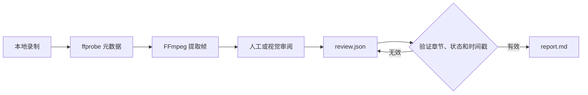

<div align="center">

# rea-game

逆向分析任意游戏视频，从游戏实录走向可玩原型。

**将游戏视频转化为带时间戳的证据、清晰的机制拆解，以及构建可玩复刻版本的实用计划。**

rea-game 将 Python 命令行工具与审阅工作流程结合起来。FFmpeg 提取视频帧，由人工或具备视觉能力的助手检查实录，再由 CLI 验证审阅内容并生成 Markdown 报告。

免费开源，采用 [MIT 许可证](../LICENSE)。


[玩法案例](#玩法案例) · [为何使用](#为何使用) · [快速开始](#快速开始) · [示例](#尝试示例) · [审阅格式](#审阅格式) · [工作原理](#工作原理) · [常见问题](#常见问题)


</div>

[中文](README_zh.md) | [English](../README.md) | [Русский](README_ru.md) | [日本語](README_ja.md) | [한국어](README_ko.md) | [Español](README_es.md) | [Português](README_pt.md) | [Français](README_fr.md) | [Deutsch](README_de.md)

> 完成分析后，可以继续制作可玩复刻版本。如果你会编程，可以使用 Claude Code 或 Codex 构建，也可以采用 [Unity](https://unity.com/)、[Unreal Engine](https://www.unrealengine.com/) 或 [Godot](https://godotengine.org/) 的开发流程。如果你不会编程，可以使用 [Seele AI](https://www.seeles.ai) 继续开发。

## 玩法案例

每个案例包含源视频、压缩的 12 帧封面（6 列 × 2 行）、带时间戳的证据帧、已完成的审阅，以及含详细时间线和玩法假设的报告。观察、推断和未解决的机制问题会分开呈现。

### Phantom Blade Zero


[观看 Phantom Blade Zero](../assets/cases/Phantom%20Blade%20Zero.mp4) · [阅读分析报告](../assets/cases/analysis/phantom-blade-zero/report.md) · [证据](../assets/cases/analysis/phantom-blade-zero/evidence.json) · [审阅](../assets/cases/analysis/phantom-blade-zero/review.json) · [提取的帧](../assets/cases/analysis/phantom-blade-zero/frames/)

<video controls preload="none" width="720"><source src="../assets/cases/Phantom%20Blade%20Zero.mp4" type="video/mp4">你的浏览器无法播放此视频。[打开视频文件](../assets/cases/Phantom%20Blade%20Zero.mp4)。</video>

### Three Kingdoms Tactics


[观看 Three Kingdoms Tactics](../assets/cases/Three%20Kingdoms%20Tactics.mp4) · [阅读分析报告](../assets/cases/analysis/three-kingdoms-tactics/report.md) · [证据](../assets/cases/analysis/three-kingdoms-tactics/evidence.json) · [审阅](../assets/cases/analysis/three-kingdoms-tactics/review.json) · [提取的帧](../assets/cases/analysis/three-kingdoms-tactics/frames/)

<video controls preload="none" width="720"><source src="../assets/cases/Three%20Kingdoms%20Tactics.mp4" type="video/mp4">你的浏览器无法播放此视频。[打开视频文件](../assets/cases/Three%20Kingdoms%20Tactics.mp4)。</video>

### Identity V


[观看 Identity V](../assets/cases/Identity%20V.mp4) · [阅读分析报告](../assets/cases/analysis/identity-v/report.md) · [证据](../assets/cases/analysis/identity-v/evidence.json) · [审阅](../assets/cases/analysis/identity-v/review.json) · [提取的帧](../assets/cases/analysis/identity-v/frames/)

<video controls preload="none" width="720"><source src="../assets/cases/Identity%20V.mp4" type="video/mp4">你的浏览器无法播放此视频。[打开视频文件](../assets/cases/Identity%20V.mp4)。</video>

## 为何使用

分析游戏实录时，很容易把你看到的内容、你认为它代表的含义，以及仍需核实的事项混为一谈。rea-game 将它们分开。观察和推断必须标注时间戳，读者便可回看证据。

你可以用它在制作原型前研究参考游戏、整理试玩记录，或为具备视觉能力的助手提供一致的审阅流程。

## 快速开始

### 1. 安装工具

你需要 Python 3.10 或更高版本、FFmpeg 和 ffprobe。在仓库页面选择 **Code → Download ZIP**，或使用 **Code** 下显示的地址克隆仓库。在下载或克隆的仓库根目录（包含 <code>pyproject.toml</code> 的目录）打开终端，然后按下文步骤从源码安装；项目目前尚未发布到 PyPI，因此暂时不能使用 <code>pip install rea-game</code> 安装。

#### macOS（终端）

先安装 [Homebrew](https://brew.sh/)，再安装 Python 和 FFmpeg：

```sh
brew install python@3.14 ffmpeg
python3.14 --version
ffmpeg -version
ffprobe -version
```

创建并启用虚拟环境，然后从仓库根目录安装 rea-game：

```sh
python3.14 -m venv .venv
source .venv/bin/activate
python -m pip install .
rea-game --help
rea-game skill
```

每次打开新终端时，都要返回仓库根目录并再次运行 <code>source .venv/bin/activate</code>。

#### Windows 10/11（PowerShell）

使用 [WinGet](https://learn.microsoft.com/windows/package-manager/winget/) 安装 Python 和 FFmpeg：

```powershell
winget install --id Python.Python.3.14 --exact
winget install --id Gyan.FFmpeg --exact
```

关闭并重新打开 PowerShell，让 PATH 更新生效。返回仓库根目录并运行：

```powershell
$env:PYTHONUTF8 = "1"
py -3.14 --version
ffmpeg -version
ffprobe -version
py -3.14 -m venv .venv
.\.venv\Scripts\python.exe -m pip install .
.\.venv\Scripts\rea-game.exe --help
.\.venv\Scripts\rea-game.exe skill
```

Windows 示例直接调用虚拟环境中的可执行文件，因此无需启用脚本或更改 PowerShell 执行策略。每次打开新的 PowerShell 会话时，设置 <code>$env:PYTHONUTF8 = "1"</code>，可确保较旧 Python 版本也一致地使用 UTF-8。

如果没有 WinGet，可从 [python.org](https://www.python.org/downloads/windows/) 安装 Python 3.14。若使用 Python 安装管理器，先运行 <code>py install 3.14</code>。从 [FFmpeg 下载页](https://ffmpeg.org/download.html) 获取 Windows 版本，再将同时包含 <code>ffmpeg.exe</code> 和 <code>ffprobe.exe</code> 的 <code>bin</code> 目录添加到用户 PATH。重新打开 PowerShell 并运行上面的版本检查；两个命令都必须能在终端中使用。

#### Linux（Ubuntu/Debian）

使用 <code>apt</code> 安装 Python、虚拟环境支持和 FFmpeg：

```sh
sudo apt update
sudo apt install python3 python3-venv ffmpeg
python3 --version
ffmpeg -version
ffprobe -version
```

确认 <code>python3 --version</code> 显示 Python 3.10 或更高版本。然后创建并启用虚拟环境，再从仓库根目录安装 rea-game：

```sh
python3 -m venv .venv
source .venv/bin/activate
python -m pip install .
rea-game --help
rea-game skill
```

### 2. 提取帧并审阅视频

macOS / Linux（已启用虚拟环境）：

```sh
rea-game extract "/path/to/gameplay.mp4" -o out/my-game --interval 3
```

Windows PowerShell：

```powershell
.\.venv\Scripts\rea-game.exe extract "C:\Videos\gameplay.mp4" -o out/my-game --interval 3
```

将视频路径换成你自己的。路径包含空格时要保留引号。<code>--interval</code> 是提取帧之间的秒数，默认值为 5。它必须是有限且大于零的数；可能导致帧数溢出的间隔会被拒绝。

如果文件包含多个视频轨道，rea-game 会使用第一个非封面图像轨道。帧尺寸、该轨道可用时的时长以及提取的图像都来自该轨道。

命令会创建一个新目录：

```text
out/my-game/
├── evidence.json   # 来源、时长、尺寸、音频情况和帧时间戳
├── frames/         # 提取的 JPEG 帧
└── review.json     # 待填写的审阅模板
```

检查提取的帧，然后回看原视频的重要片段，确认这些帧之间发生了什么。分析声音前先听音频。时间戳表示请求的定位位置；实际解码出的帧可能略有不同。

### 3. 生成报告

用文本编辑器打开 <code>out/my-game/review.json</code>，按照[审阅格式](#审阅格式)填写发现，并以 UTF-8 保存。默认使用英文撰写。然后运行：

macOS / Linux：

```sh
rea-game report out/my-game
```

Windows PowerShell：

```powershell
.\.venv\Scripts\rea-game.exe report out/my-game
```

报告会保存到 <code>out/my-game/report.md</code>。内容涵盖玩法循环、操作、规则、进度、界面、美术、声音、原型计划和待解决问题，并给出继续制作可玩复刻版本的建议。空白章节会显示 “Not yet reviewed.”。

## 尝试示例

仓库包含一个生成三秒合成视频的脚本：黑色背景上的白色方块会在一秒处改变位置。这个示例无需下载游戏素材，可演示提取和生成报告的流程，但不是完整的游戏玩法案例。

| 0 秒 | 1 秒 |
| --- | --- |
|  |  |

在仓库根目录运行。macOS / Linux 用户需先启用虚拟环境：

```sh
python examples/synthetic/create_video.py out/synthetic.mp4
rea-game extract out/synthetic.mp4 -o out/synthetic --interval 1
cp examples/synthetic/review.json out/synthetic/review.json
rea-game report out/synthetic
```

Windows PowerShell：

```powershell
$env:PYTHONUTF8 = "1"
.\.venv\Scripts\python.exe examples/synthetic/create_video.py out/synthetic.mp4
.\.venv\Scripts\rea-game.exe extract out/synthetic.mp4 -o out/synthetic --interval 1
Copy-Item examples/synthetic/review.json out/synthetic/review.json
.\.venv\Scripts\rea-game.exe report out/synthetic
```

复制示例审阅文件前，先检查帧并播放视频，确认方块确实移动。再次运行示例时，请使用新的视频路径和输出目录。

参见[示例报告](../examples/synthetic/report.md)、[审阅文件](../examples/synthetic/review.json)和[分步指南](../examples/synthetic/README.md)。示例报告中的来源路径是 <code>out/synthetic.mp4</code>；你生成的报告会记录实际本地路径。

## 审阅格式

每个章节都包含一个条目数组。每个条目都需要 <code>text</code> 和 <code>status</code>；<code>times</code> 为可选项，但观察和推断必须至少引用一个录制范围内的时间戳：

```json
{
  "core_loop": [
    {
      "text": "The counter increases when the character touches an item.",
      "status": "observation",
      "times": [12.3]
    }
  ],
  "unknowns": [
    {
      "text": "Do collected items respawn after a delay?",
      "status": "unverified",
      "times": []
    }
  ],
  "remake": [
    {
      "text": "Start with movement, item collection, and an on-screen counter.",
      "status": "proposal",
      "times": []
    }
  ]
}
```

这些是格式示例，并非对你的视频作出的结论。保留生成模板中的章节键名。系统会拒绝未知章节和条目字段，以便发现拼写错误。

| 状态 | 用途 | 时间戳 |
| --- | --- | --- |
| <code>observation</code> | 录制中可直接看到或听到的内容 | 必填 |
| <code>inference</code> | 有证据支持但尚未确认的解释 | 必填 |
| <code>unverified</code> | 视频无法解答的问题或无法确认的说法 | 可选 |
| <code>proposal</code> | 构建原型时可采用的方案 | 可选 |

原型计划应说明最小可玩版本、核心机制、所需场景与素材，以及实现顺序。单靠视频通常无法确认输入映射、隐藏数值、所有胜负条件或原始技术栈。请明确保留这些不确定项。

## 工作原理



CLI 使用 Python 标准库处理参数、JSON、文件和子进程。FFmpeg 负责视频解码。审阅数据是易读的 JSON，报告是普通 Markdown。运行已安装的工具不需要模型、API 密钥或网络连接。如果你使用云端助手，视频是否上传取决于该助手的工作流程。

生成报告前，rea-game 会检查：

- <code>evidence.json</code> 中是否有非空来源、有限且大于零的时长，以及有效帧索引。
- <code>review.json</code> 中是否使用已知章节名称和条目字段。
- 状态是否合法、文本是否非空、时间戳是否为录制范围内的有限数值。观察和推断必须包含时间戳。

为保护现有审阅内容，提取时必须使用新输出目录。如果提取失败，程序会删除本次运行创建的目录，方便重试。生成报告会覆盖所选目录中的 <code>report.md</code>。

## 测试与软件包

测试涵盖从 FFmpeg 到报告生成的完整流程、多个视频轨道的一致性、极小间隔、无效 JSON、字段验证、时间戳边界，以及提取失败后的清理。CI 在 Linux、macOS 和 Windows 上针对 Python 3.10 和 3.14 运行。它会执行测试、构建 wheel 和源码分发包，并在隔离环境中安装各软件包以运行示例，但不会发布软件包。实际结果请查看仓库的 Actions 运行记录。

开发和发布检查请参阅[贡献指南](../CONTRIBUTING.md)。

## 常见问题

<details>
<summary>rea-game 是免费的吗？</summary>

是。rea-game 是采用 MIT 许可证发布的开源软件。CLI 没有订阅、API 密钥或使用费用。你选择使用的付费 AI 助手或开发服务需另行付费。

</details>

<details>
<summary>rea-game 有什么用途？</summary>

rea-game 会将游戏视频片段整理为结构化、以证据为依据的分析报告，为原型开发提供参考。它会提取带时间戳的帧，提供涵盖玩法、操作、规则、进度、UI、美术和音频的审阅流程，验证审阅内容，并生成包含原型计划和待解决问题的 Markdown 报告。

</details>

<details>
<summary>rea-game 会自动分析视频吗？</summary>

不会。CLI 只提取帧并根据你的审阅生成报告，它本身无法理解游戏玩法。你需要亲自检查画面和相关视频片段，或请具备视觉能力的助手协助，再填写分析。对于视频无法确认的细节，请标记为未验证，不要把猜测当作已确认规则。

</details>

<details>
<summary>分析报告有什么用？</summary>

报告帮助你理解并说明游戏中可见的玩法循环、互动、反馈和未解决的机制问题。原型计划会把发现整理为初步范围、核心机制、建议的场景与素材、技术选项及实现顺序。它可作为规划可玩复刻版本的实用交接材料，但不是完整的游戏规格说明。

</details>

<details>
<summary>我可以根据报告制作可玩的游戏吗？</summary>

报告提供的是有依据的起点，不是完整的游戏代码或素材。如果你会编程，可以继续使用 Claude Code 或 Codex，也可以用 [Unity](https://unity.com/)、[Unreal Engine](https://www.unrealengine.com/) 或 [Godot](https://godotengine.org/) 开发。如果你不会编程，可以使用 [Seele AI](https://www.seeles.ai) 继续开发。

</details>

<details>
<summary>使用 rea-game 需要编程技能吗？</summary>

你不需要游戏开发技能，但 rea-game 是本地命令行工作流程，不是一键式网页服务。你需要安装 Python 和 FFmpeg、运行几条命令，并填写 <code>review.json</code>。你可以自行检查视频，也可以请具备视觉能力的助手协助审阅。随后，报告会帮助你选择适合自身技能的开发路径。

</details>

<details>
<summary>应该分析哪类视频？</summary>

选择能展示玩家操作及其屏幕反馈的游戏实录。短片段适合说明某个具体互动；包含完整玩法循环的较长录制能提供更多背景。如果片段没有展示操作方式、结果或状态转换，请将它们记为待解决问题。

</details>

<details>
<summary>视频会离开我的电脑吗？</summary>

CLI 在本地处理视频文件，不需要模型、API 密钥或网络连接。如果你让云端助手检查视频，是否上传取决于该助手的工作流程和设置。

</details>

<details>
<summary>为什么提取时必须使用新目录？</summary>

这样可以保护已有的审阅内容。成功生成的输出目录由你自行管理；提取失败时只会删除本次运行创建的目录。

</details>

<details>
<summary>我可以用其他语言填写审阅内容吗？</summary>

可以。CLI、报告标题、示例和助手工作流程默认使用英文。报告会保留你输入的文字，不会自动翻译。状态值必须始终使用 <code>observation</code>、<code>inference</code>、<code>unverified</code> 或 <code>proposal</code>。

</details>

<details>
<summary>分享报告前应检查什么？</summary>

报告和 <code>evidence.json</code> 都包含视频的本地路径。分享前请检查路径中是否包含隐私信息，并确认你有权使用相关视频、截图、音乐和游戏素材。仓库的 MIT 许可证不授予第三方游戏内容的使用权。

</details>

## 参与贡献

欢迎提交错误报告、建议和拉取请求。有关环境设置、问题反馈和发布检查，请参阅[贡献指南](../CONTRIBUTING.md)。

macOS / Linux（已启用虚拟环境）：

```sh
python -m unittest discover -s tests
```

Windows PowerShell：

```powershell
$env:PYTHONUTF8 = "1"
.\.venv\Scripts\python.exe -m unittest discover -s tests
```

## 致谢与许可证

本项目受到 REA（Reverse Engineer Anything）启发：从所见追溯其实现方式，以证据支持每项说法，并通过测量进行验证。

代码和原创合成示例采用 [MIT 许可证](../LICENSE)。更多详情请参阅[审阅工作流程](../rea_game/SKILL.md)和[更新日志](../CHANGELOG.md)。
